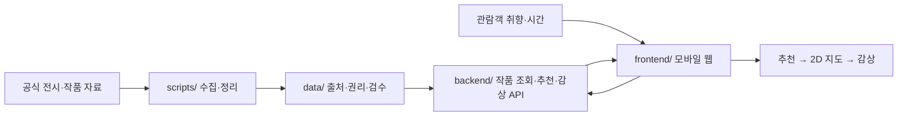
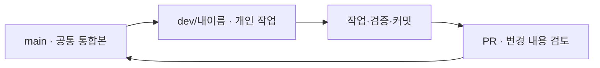

# 🎨 ARTI

**처음 보는 작품도, 나만의 방식으로 감상할 수 있도록.**

ARTI는 미술 감상 초보자를 위한 **AI 기반 개인화 전시 관람 어시스턴트**입니다. 가천대학교 2026학년도 2학기 졸업프로젝트 팀이 개발하고 있습니다.

> **현재 상태:** 개발 초기 단계. 이 문서에 적힌 기능은 서비스의 목표이며, 구현·배포가 완료됐다는 뜻은 아닙니다. 기획·일정·팀 합의는 [ARTI Notion](https://app.notion.com/p/26-2-ARTI-a3534713f16782789905811787871032)을 기준으로 확인합니다.

## 1. 어떤 서비스인가요?

미술을 잘 모르는 관람객이 전시 입구에서 QR을 스캔하면, **취향에 맞는 작품을 추천받고, 어디서 무엇을 볼지 확인하고, 작품을 보면서 스스로 생각할 질문을 만나는** 경험을 지향합니다.

```text
[전시 입구 QR/URL]
         ↓
[작품 취향 선택 + 관람 가능 시간]
         ↓
[나에게 맞는 작품 추천 + 추천 이유]
         ↓
[2D 지도에서 관람 순서·작품 위치 확인]
         ↓
[작품 설명 + 관찰 질문(Guided Looking)]
         ↓
[다음 작품으로 이동] → ... → [관람 마무리]
```

단순히 AI가 정답을 말하는 것보다, **검증된 작품 정보로 관람객의 감상을 돕는 것**을 중요하게 생각합니다.

## 2. 이번 개발에서 먼저 만드는 것

| 우선순위 | 목표 | 비고 |
| --- | --- | --- |
| **P0** | 전시 한 개와 검증된 작품 3~5점, 비회원 진입, 취향·시간 입력, 추천, 2D 지도, 기본 해설을 **연결** | 중간발표용 최소 흐름 |
| **P1** | 관찰 질문/근거 기반 작품 Q&A 또는 간단한 관람 기록 중 일부 추가 | P0가 동작한 다음 |
| 이후 | 회원·관리자 기능 고도화, TTS, 더 정교한 경로 추천 | 범위·우선순위 별도 결정 |

**아직 확정되지 않은 사항:** 프론트/백엔드 기술 스택의 최종 선택, API 응답 규격, DB·배포 방식, 실제 전시/작품 데이터 및 이미지 사용권.

2D 지도상의 '현재 위치'는 **관람 진행을 기준으로 표시하는 위치**이고, GPS로 사람을 추적하는 기능이 아닙니다.

자세한 범위: [docs/PROJECT_SCOPE.md](docs/PROJECT_SCOPE.md)

## 3. 코드와 데이터는 어떻게 이어지나요?



작품 하나를 **같은 ID**로 데이터 → API → 화면까지 연결하고, 전시 소속·이미지 권리·해설 출처를 확인합니다.

## 4. 폴더별 안내

| 위치 | 어떤 일을 하나요? | 처음 확인할 문서 |
| --- | --- | --- |
| [frontend/](frontend/) | 관람객 모바일 화면·관리 화면, API 결과 표시 | [프론트 가이드](frontend/README.md) |
| [backend/](backend/) | 작품 조회, 추천, 지도 정보, 감상 기능용 API | [백엔드 가이드](backend/README.md) |
| [data/](data/) | 작품·전시 데이터 형식, 출처·권리·검수 기록 | [데이터 가이드](data/README.md) |
| [scripts/](scripts/) | 원자료 수집·정제·변환 작업 | [파이프라인 가이드](scripts/README.md) |
| [docs/](docs/) | 범위·협업·API 결정사항·시작 안내 | [문서 길잡이](docs/README.md) |
| [.github/](.github/) | PR 및 Issue 양식 | [협업 도구 안내](.github/README.md) |

> 폴더의 존재는 **실제 기능이 구현됐음을 의미하지 않습니다.** 앱 실행 명령은 코드가 추가되면 각 파트 README에 적습니다.

## 5. 팀원이라면 여기부터

**팀원 초대 후 처음 할 일**
1. 저장소 접근 확인 → [팀원 시작 가이드](docs/TEAM_ONBOARDING.md)
2. 본인 브랜치 `dev/이름` 선택 (이미 생성해 두는 방식)
3. 맡은 작업의 Issue·관련 Notion 확인
4. **개인 브랜치에서 작업 → 커밋 → PR → `main`에 병합**



- **커밋 제목:** 영어 유형 + 한국어 내용. 예: `feat: 작품 추천 화면 구현`
- **PR 제목·설명·리뷰:** 한국어 중심
- **`main`에 바로 push하지 않기.** 각자 브랜치의 변경은 PR로 검토 후 통합
- 브랜치 재사용 시에는 다음 작업 전 최신 `main` 반영

자세한 흐름: [협업 규칙](docs/CONTRIBUTING.md) · [그림으로 보는 개발 흐름](docs/WORKFLOW.md)

## 6. 자료와 작업을 어디에서 관리하나요?

| 무엇을 남기나요? | 어디에 남기나요? |
| --- | --- |
| 회의에서 정한 방향·일정·담당·원자료 | [ARTI Notion](https://app.notion.com/p/26-2-ARTI-a3534713f16782789905811787871032) |
| 개발해야 할 기능·버그 | [GitHub Issues](../../issues) |
| 코드 변경·검토·병합 | [GitHub Pull Requests](../../pulls) |
| 현재 개발 전 합의가 필요한 인터페이스 | [API 논의사항](docs/API_DECISIONS.md) |

이 저장소에는 **비밀번호, API 키, 개인 연락처, 권리를 확인하지 않은 이미지 원본**을 올리지 않습니다.

---
**관련 Notion**: [전체 협업 공간](https://app.notion.com/p/26-2-ARTI-a3534713f16782789905811787871032) · [10/12 구현 착수안](https://app.notion.com/p/3f734713f16781dda4fef887384ac17d) · [개발 1단계](https://app.notion.com/p/3fa34713f167804ebb23c251498f3c5a)
