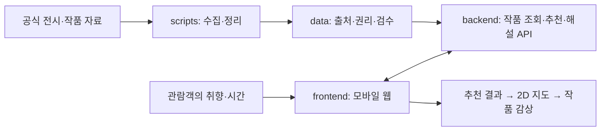
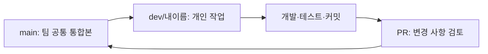

# 🎨 ARTI | 나만의 전시 관람을 돕는 AI 어시스턴트

> **처음 보는 작품 앞에서도 무엇을 보고 생각할지 알 수 있도록.**

ARTI는 **미술 감상 초보자**가 자신의 취향에 맞는 작품을 찾고, 추천된 순서대로 전시를 둘러보며, 작품을 스스로 이해하도록 돕는 **AI 기반 개인화 미술관 관람 서비스**입니다. 가천대학교 **2026학년도 2학기 졸업프로젝트**로 개발하고 있습니다.

**바로가기:** [팀 Notion](https://app.notion.com/p/26-2-ARTI-a3534713f16782789905811787871032) · [10/17 개발·발표 현황](https://app.notion.com/p/3fc34713f167814bb884e2bf31a8bdb9) · [처음 시작하기](docs/처음-시작하기.md) · [협업 규칙](docs/협업-규칙.md) · [개발 범위](docs/프로젝트-범위.md) · [PR 목록](https://github.com/2026-2-zolp/arti/pulls)

## 👀 지금 어디까지 진행됐나요?

**기준: 2026-10-17 · 팀 협업환경 준비 완료 / 실제 구현 진행은 코드·PR을 기준으로 확인**

| 구분 | 실제 상태 | 다음 작업 |
| --- | --- | --- |
| 프로젝트 기획·기본 사용자 흐름 | **방향 정리됨** | 세부 개발 범위는 Notion 합의 기준 |
| 화면설계 | **제안안 있음** | 사용자 핵심 화면부터 구현 |
| GitHub 협업 공간 | **초기 구성 완료** | 팀원 초대 및 개발 착수 |
| 프론트엔드 화면 | **목업 기반 실제 화면 구현 중** (팀 공유 기준) | 작업 코드 GitHub 반영·실행 확인 |
| 백엔드·AI | **기술 설계 문서 확인됨, 실제 구현은 미확인** | 작업 코드·실행 결과 공유 및 진도 확인 |
| 실제 작품 데이터·지도 연동 | **통합 구현·검증 미확인** | 한 전시, 작품 3~5점으로 검증 |
| 배포 및 통합 시연 | **아직 없음** | 화면 ↔ API ↔ 작품 데이터를 연결 |

> **중요:** 현재 프론트엔드는 팀원이 로컬에서 작업 중이라고 공유한 상태이지만, 이 GitHub 저장소에는 아직 실제 앱 소스가 올라오지 않았습니다. 백엔드·AI는 상세 설계 자료가 있으나 실행되는 코드는 확인되지 않았습니다. **기획됨 / 구현됨 / 검증됨**을 구분합니다.

### 지금 팀은 이렇게 나눠 개발합니다

| 파트 | 참여 | 작업 내용 | 지금 확인할 것 |
| --- | --- | --- | --- |
| **프론트엔드** | **지성현·김동섭** | 기존 화면설계·목업을 실제 모바일 웹 화면으로 구현 | 화면별 구현 진도 및 코드 공유 |
| **백엔드·AI** | **임준억·김광권** | 전시/작품 API, 데이터 준비, 추천·감상 기능 검토·개발 | 광권님 기존 작업물 확인, 구현 범위 나누기 |
| **연동·통합** | **양쪽 공동** | 같은 전시·작품 ID와 추천 결과 형식으로 실제 화면 연결 | 최소 API 요청·응답 합의 |

- [김광권님 백엔드·AI 설계 자료](https://app.notion.com/p/3f034713f16780d39decdc6996c7994c): 아키텍처·ERD·추천·RAG·API 초안. **설계와 코드 구현 여부는 별개**입니다.
- [개발 1단계](https://app.notion.com/p/3fa34713f167804ebb23c251498f3c5a): 팀원별 진행 자료·연동 논의.
- 역할은 현재 팀 공유 기준이며 **각 기능별 세부 담당과 완료 여부는 작업물을 보고 조정**합니다.

**가까운 일정:** 10/18(일) 18:00 중간발표 자료 제출, 10/19~20 중간발표. 일정·담당 변경은 [Notion의 프로젝트 일정](https://app.notion.com/p/26-2-ARTI-a3534713f16782789905811787871032)에서 확인합니다.

## 🖼️ 사용자는 ARTI를 어떻게 이용하나요?

예를 들어, 미술관에 처음 온 사람이 전시 입구의 QR을 스캔했다고 가정해 봅시다.

```text
① 전시 입구의 QR 또는 링크로 모바일 웹 접속
                ↓
② 마음에 드는 작품·취향 + 관람 가능 시간 선택
                ↓
③ 내게 맞는 작품과 추천 이유 확인
                ↓
④ 2D 지도에서 작품 위치와 추천 관람 순서 확인
                ↓
⑤ 작품 앞에서 짧은 설명과 관찰 질문 확인
                ↓
⑥ 감상 완료 → 다음 추천 작품으로 이동
                ↓
⑦ (추후 확장) 오늘의 관람 기록 · 아트 영수증
```

**이 서비스가 해결하려는 문제:** 미술을 잘 모르는 관람객이 “어떤 작품부터 볼지?”, “이 작품에서 뭘 봐야 할지?”를 혼자 해결해야 하는 부담을 줄이는 것.

**AI가 하는 일:** 취향에 따른 작품 추천을 돕고, **근거를 확인한 작품 정보**를 바탕으로 질문을 던져 감상을 지원합니다. 작품 해석의 정답을 강요하거나, 확인되지 않은 내용을 사실처럼 말하는 것은 목표가 아닙니다.

### 핵심 기능의 우선순위

| 단계 | 이번에 만들 내용 | 범위 판단 |
| --- | --- | --- |
| **P0 — 우선 구현** | 전시 1개, 작품 **3~5점**의 검증 데이터 → 비회원 취향·시간 입력 → 추천·이유 → 2D 지도 → 기본 작품 해설 | **같은 데이터와 ID로 화면·API가 실제 연결되는지**가 핵심 |
| **P1 — 여유 시 추가** | 작품 감상을 유도하는 **Guided Looking** 1문답, 근거 기반 질문응답 또는 간단한 관람 결과 중 하나 | P0 동작 확인 후 |
| **후속 개발** | 로그인/기록, 관리자 기능, 음성(TTS), 고도화된 동선 추천 | 설계와 별개로 일정 조정 |
| **현재 범위 밖** | 실시간 실내 GPS, 3D 내비게이션, 모든 미술관 연동, 대규모 자체 모델 학습 | 중간발표 필수 아님 |

**지도에 표시하는 '현재 위치'는 GPS가 아닙니다.** 전시 입구 또는 직전에 감상한 작품을 기준점으로 보여 주는 **관람 진행 상태**입니다.

### 전시 데이터는 무엇을 사용하나요?

**첫 구현 대상으로 확정된 전시는 서울시립미술관 〈유영국: 산은 내 안에 있다〉입니다.** [10/12 실제 회의 결과](https://app.notion.com/p/3fb34713f1678122bbf9f2c856b50ce8)에 따른 결정이며, National Gallery의 신인상주의 전시 〈Radical Harmony〉는 **후속 확장 후보**로 유지합니다. 첫 구현에 사용할 작품 수와 실제 출품작·공식 해설·이미지 사용권·지도 배치 자료는 아직 검증·확정이 필요합니다.

[개발 범위 자세히 보기 →](docs/프로젝트-범위.md)

## 🔗 시스템은 어떤 순서로 연결되나요?



예를 들어 **한 작품의 `artwork_id`**를 정하면, 데이터 파일에서 이 작품을 찾고 → 백엔드가 같은 ID로 응답하고 → 프론트엔드가 추천·지도·해설 화면에 동일 작품을 표시해야 합니다.

**작업 순서는** 작품·전시 데이터의 근거를 확인하고 → 최소 API의 요청·응답을 합의하고 → 화면과 연결하는 식으로 진행합니다. 기술 스택(Django/DRF, DB, 호스팅 등)은 기존 문서에 **후보**가 있지만 최종 선택과 실제 설치 여부는 별도로 판단합니다.

## 📁 어떤 폴더에서 무엇을 하나요?

```text
arti/
├── frontend/       관람객·관리자 웹 화면
├── backend/        API·작품 추천·감상 관련 로직
├── data/           검증 가능한 전시·작품 데이터
├── scripts/        데이터 수집·변환·검수 작업
├── docs/           처음 시작하기·협업·기술 논의 문서
├── .github/        PR 양식 (Issue 템플릿은 사용하지 않음)
├── .env.example    추후 환경변수 안내
└── README.md       지금 보고 있는 전체 안내
```

| 담당 영역 | 첫 번째로 할 일 | 해당 안내 |
| --- | --- | --- |
| **프론트엔드** | 모바일 진입 → 취향 → 추천 → 지도 → 감상 화면 연결 | [frontend/README](frontend/README.md) |
| **백엔드** | 전시/작품 조회와 추천 결과·좌표·해설 반환 규격 합의 | [backend/README](backend/README.md) |
| **데이터** | 작품 3~5점의 출처·검수·이미지 권리 상태 정리 | [data/README](data/README.md) |
| **데이터 처리** | 공식 자료 → 정리된 데이터로 만드는 방법 문서화 | [scripts/README](scripts/README.md) |
| **공통 문서** | 개발 범위·API 논의·업무 흐름 확인 | [docs/문서 안내](docs/README.md) |
| **AI·추천 (구현본)** | 감정 분석 AI·추천 기준·검증 결과, Windows 실행 방법 | [AI·추천 정리](docs/AI-감정분석-추천-정리.md) · [Windows 실행 가이드](docs/실행-가이드-Windows.md) |

각 폴더에는 **역할 → 데이터 입출력 → 작업 순서 → 유의사항**을 설명하는 README가 있습니다. 실제 앱이 만들어지면 **실행 명령·설치 방법·필요한 환경변수**도 해당 폴더에 추가합니다.

## 👥 팀원이 처음 들어오면?

**이 저장소는 모노레포 하나만 사용합니다.** 각자 저장소를 새로 만드는 것이 아니라 **같은 `arti`의 다른 브랜치**에서 개발합니다. **코드·실제 구현 변경은 GitHub 커밋/PR, 담당·일정·발표용 현황 취합은 Notion**에서 관리합니다.



| 팀원 | 개인 브랜치 |
| --- | --- |
| 임준억 | `dev/임준억` |
| 김광권 | `dev/김광권` |
| 지성현 | `dev/지성현` |
| 김동섭 | `dev/김동섭` |

**처음 3단계**
1. GitHub 조직 초대를 수락하고 [처음 시작하기](docs/처음-시작하기.md)에서 내 브랜치를 여는 방법을 확인합니다.
2. Notion에 있는 담당 작업을 확인하고 **`dev/내이름`**에서 개발합니다.
3. 코드를 확인·커밋한 뒤 **PR(`dev/내이름` → `main`)**로 검토받고 병합합니다.

**커밋 제목:** 유형은 영어, 설명은 한국어로 작성합니다.
- `feat: 작품 추천 화면 구현`
- `fix: 지도 마커 표시 오류 수정`
- `docs: 프론트엔드 실행 방법 정리`

**PR 설명은 세 가지만 적으면 충분합니다:** 무엇을 바꿨는지 / 어떻게 확인했는지 / 참고·미완료 사항. **GitHub Issue 작성은 필수가 아닙니다.** 중요한 업무와 담당자는 기존 Notion에서 관리합니다.

[처음 시작하기 →](docs/처음-시작하기.md) · [개발·PR 흐름 그림 →](docs/개발-PR-흐름.md) · [협업 규칙 →](docs/협업-규칙.md)

## 📌 Notion과 GitHub는 이렇게 나눕니다

| 정보 | 기준 공간 |
| --- | --- |
| 기획·회의 결정·작업 배분·일정·조사 근거 | [ARTI Notion](https://app.notion.com/p/26-2-ARTI-a3534713f16782789905811787871032) |
| 개발 진도 요약·PPT 증빙·미결 사항 | [10/17 개발 현황 취합](https://app.notion.com/p/3fc34713f167814bb884e2bf31a8bdb9) (실제 코드·PR 링크 인용) |
| 소스코드·실행 방법·구현 여부·API 연동 명세 | 이 GitHub 저장소 (커밋/PR과 실행 결과를 근거로 확인) |
| 코드 변경 이유·검증 결과·합치는 과정 | [Pull Requests](https://github.com/2026-2-zolp/arti/pulls) |
| 선택적으로 남길 버그·기술 검토 | [Issues](https://github.com/2026-2-zolp/arti/issues) |

**유의:** 민감한 키·개인정보·무단 재배포 이미지·검증 전 자료를 저장소에 커밋하지 않습니다. 공식 사실과 AI 생성 해석을 구분합니다.

---

**기획 참고:** [ARTI 전체 Notion](https://app.notion.com/p/26-2-ARTI-a3534713f16782789905811787871032) · [10/12 구현 착수안](https://app.notion.com/p/3f734713f16781dda4fef887384ac17d) · [개발 1단계](https://app.notion.com/p/3fa34713f167804ebb23c251498f3c5a)
