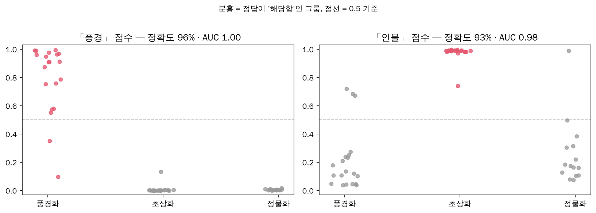

# 🧠 AI Service — 작품 태그·감정 분석 서버 (Python · FastAPI)

현재 Django 분석 연동의 기동·로딩/과부하·timeout·중단/복구 정책은 [로컬 운영 기준](../docs/operations/모델서비스_로컬운영.md)을 따른다. 아래 Claude/Kanana 작성 흐름은 보존된 legacy 설명이며 새 Django의 GPT 텍스트 경로와 구분한다.

[← 메인 안내로](../README.md) · [백엔드](../backend/README.md)

관리자가 작품을 등록하고 **「AI 분석」**을 누르면, 백엔드가 이 서버에 작품 그림(과 해설)을 보내고 두 가지를 받아 옵니다.

| 결과 | 내용 | 쓰이는 곳 |
|---|---|---|
| **취향 태그 8개** (0~1, 태그마다 독립) | 풍경 · 인물 · 추상 · 빛 · 강렬한 색감 · 차가운 색감 · 따뜻한 색감 · 부드러운 색감 (`app/tags.py`) | **추천** — 사용자 취향 카드 = 관리자 태그 = AI 태그 (같은 8개) |
| 감정 6개 | 평온 · 기쁨 · 슬픔 · 긴장 · 경외 · 그리움 (`app/emotions.py`) | 작품 분위기 설명(U-10), 아트 영수증(U-12) — 추천에는 쓰지 않음 |

```text
[A-04 관리자] 「AI 분석」 ──▶ backend ──▶ ai-service /analyze ──▶ 태그 점수 + 감정 점수
                               ├──▶ ai-service /write   ──▶ 요약 + 초보자 가이드 (Kanana, API 키가 없을 때)
                               └──▶ Claude API         ──▶ 요약 + 초보자 가이드 (API 키가 있을 때)
                    「AI 제안」 저장 ──▶ 관리자 확인·수정 ──▶ 「확정」 ──▶ 추천·사용자 화면에 반영
```

## 사용하는 오픈소스 모델 (학습 없이 쓰는 "제로샷")

> **파인튜닝(추가 학습)은 하지 않았습니다.** 사전학습 모델을 그대로 쓰고, ① 태그·감정 문장(프롬프트) 설계 ② 감정 라벨 편향 보정 ③ 모델 비교로 성능을 맞췄습니다.
> 동작 원리·추천과의 연결·검증 결과를 한 번에 보려면 [AI·추천 정리](../docs/AI-감정분석-추천-정리.md).

| 대상 | 모델 | 방식 | 라이선스 |
|---|---|---|---|
| 작품 이미지 | [`openai/clip-vit-base-patch32`](https://huggingface.co/openai/clip-vit-base-patch32) (CLIP) | **태그:** 태그마다 "해당하는 그림"·"해당하지 않는 그림" 문장 중 어느 쪽에 가까운지 → 0~1 / **감정:** "a calm and peaceful painting" 같은 감정 문장과의 유사도 | OpenAI CLIP 저장소 MIT |
| 한국어 해설 | [`MoritzLaurer/mDeBERTa-v3-base-mnli-xnli`](https://huggingface.co/MoritzLaurer/mDeBERTa-v3-base-mnli-xnli) (다국어 NLI) | **감정:** 해설이 "이 글이 묘사하는 작품의 분위기는 평온함이다"를 얼마나 뒷받침하는지 / **태그:** 그림이 없을 때만 해설로 판단(색은 글로 판단하기 어려워 참고용) | MIT |
| 초보자용 글쓰기 | [`kakaocorp/kanana-1.5-2.1b-instruct-2505`](https://huggingface.co/kakaocorp/kanana-1.5-2.1b-instruct-2505) (카카오 한국어 대화형 모델) | **요약 + 키워드 + 초보자 가이드**(쉬운 설명 · 관찰 질문 3개 · 힌트)를 한 번에 작성. 원문에 없는 연도·숫자가 들어간 문장은 버림 (`app/writer.py`) | Apache 2.0 |

**글쓰기 모델을 Kanana로 고른 이유 (2026-11-01 비교, 같은 해설 5개, CPU 4코어):**

| | Kanana 1.5 2.1B | Qwen3 4B | EXAONE 4.0 1.2B | KoBART 요약 |
|---|---|---|---|---|
| 작품 1개 (요약 + 질문) | 30~40초 | 60~77초 | 10~13초 | 2~6초 (요약만) |
| 형식 (요약 + 질문 3개) | ✅ | ✅ | ❌ 질문을 안 만듦 | ❌ 질문 불가 |
| 사실 · 한국어 | 작은 오류 2~3건, 해요체 가장 자연스러움 | 가장 정확, 말투 섞임 | 지어냄, 영어 섞임 | 지어냄("1999년 서울") |
| 라이선스 | Apache 2.0 | Apache 2.0 | 연구·비상업 | — |

작은 모델이라 가끔 틀린 내용을 써요(예: 「야경」을 "밤하늘 아래"라고 씀). 그래서 결과는 항상 **「AI 제안」**으로 저장되고 **관리자가 확인·확정**해야 사용자 화면에 보여요.

- **태그는 그림이 있으면 그림으로만** 판단합니다(그림 없으면 해설로). 0.5 이상이면 "해당함"으로 보고 관리자 화면에서 태그 버튼을 미리 켭니다.
- **「강렬한 색감」 문장**은 같은 그림의 채도를 낮추고 높여 시험해 골랐습니다(다른 후보는 거의 모든 그림을 0점으로 판단). **「빛」 문장**은 캡처 40점에서 후보 4개를 비교해 어둠 속 광원도 찾는 문장으로 골랐습니다.
- **태그별 기준값** (`app/tag_calibration.json`, 캡처 40점 팀 6명 다수결 정답으로 정함): 빛 0.95 · 강렬한 0.90 · 따뜻한 0.90, 나머지 0.5. 서버가 기준값이 0.5가 되도록 점수를 다시 매겨 보내므로(`tags`, 보정 전은 `tagsRaw`) 백엔드·화면은 0.5로 판단합니다. 그림으로 판단한 태그에만 적용합니다.

- **감정 6가지:** 평온 · 기쁨 · 슬픔 · 긴장 · 경외 · 그리움 (`app/emotions.py`에서 이름·문장을 바꿀 수 있음)
- **합치는 방법:** 이미지 60% + 텍스트 40% 가중 평균 → 가장 강한 감정을 1로 맞춘 상대 점수(0~1). 이미지가 없거나 내려받지 못하면 텍스트만 사용
- **재현성:** 무작위 요소가 없어 같은 입력에는 항상 같은 점수가 나옵니다
- **라벨 편향 보정:** 텍스트 모델은 어떤 해설이든 '경외'에 높은 점수를 주는 편향이 있어(평균 0.53, '평온'은 0.07), 감정별 평균 점수(`app/calibration.json`)를 뺀 뒤 가장 낮은 감정이 0이 되게 맞춰 보정합니다(편향을 뺀 순서를 끝까지 유지). `python -m evaluation.evaluate --save-calibration`으로 다시 만들 수 있어요(실제 전시 작품으로 다시 생성 권장).
- **이미지 입력:** 관리자가 A-04에서 **캡처한 이미지 파일을 올리면** 파일 내용이 그대로(base64) 이 서버로 전달됩니다. 이미지 URL도 지원합니다.
- **한계 (검증 노트북):** 예시 정답 11점 기준 텍스트 분석 정확도는 **Top-1 45%, Top-2 73%**(보정 후, 무작위 기준 27%·50%)로 "대략적인 경향" 수준이고, 정답이 '기쁨'인 작품을 특히 못 맞힙니다. 이미지 분석(CLIP)은 풍경·밝은 그림에서 자연스럽고 어두운 그림·초상에서 어색했습니다(정답 없는 정성 확인). 그래서 결과는 **「AI 제안」**으로만 저장하고 관리자가 확인한 뒤 확정합니다

## 실행

Python **3.10 이상**이 필요합니다. 처음 실행할 때 모델 파일(약 1.7GB)을 Hugging Face에서 자동으로 내려받습니다.

```bash
cd ai-service
python -m venv .venv
# Windows: .venv\Scripts\activate   /   Mac·Linux: source .venv/bin/activate
pip install -r requirements.txt
uvicorn app.main:app --port 8000
```

- PyTorch 용량을 줄이려면(Linux, GPU 없음) 먼저 `pip install torch --index-url https://download.pytorch.org/whl/cpu` 후 나머지를 설치하세요. Windows·Mac은 기본 설치가 CPU 버전입니다.
- 서버가 뜨면 모델을 백그라운드에서 미리 불러옵니다. `http://localhost:8000/health`의 `modelsLoaded`가 `true`가 되면 준비 완료입니다.
- 백엔드는 기본으로 `http://localhost:8000`을 호출합니다. 주소를 바꾸면 `backend/.env`의 `EMOTION_SERVICE_URL`을 맞춰 주세요.

### 전체 실행 순서 (터미널 3개)

```bash
cd ai-service && uvicorn app.main:app --port 8000   # 1) AI 분석 서버 (태그·감정)
cd backend && npm run dev                           # 2) API 서버 :4000
cd frontend && npm run dev                          # 3) 화면 :5173
```

AI 분석 서버를 띄우지 않아도 나머지 기능은 모두 동작합니다(「AI 분석」만 "서버에 연결할 수 없어요" 안내, 추천은 관리자가 켠 태그로).

## API

| 메서드 | 경로 | 설명 |
|---|---|---|
| GET | `/health` | `{ ok, modelsLoaded, calibration, tagThresholds, writer: { enabled, model, loaded } }` |
| GET | `/tags` | 취향 태그 8개 목록 |
| GET | `/emotions` | 감정 항목 목록 |
| POST | `/analyze` | `{ title, description, imageBase64?, imageUrl? }` → `{ tags, tagSource, emotions, imageScores, textScores, usedImage, imageError, models }` |
| POST | `/write` | `{ title, artist, year, description }` → `{ summary, keywords, intro, questions, hints, model, seconds, dropped }` (Kanana, 작품 1개에 30~40초. 처음 요청 때 모델 약 4GB를 내려받고 불러와요) |

```json
// POST /analyze 응답 예시
{
  "tags": { "landscape": 0.87, "people": 0.35, "abstract": 0.08, "light": 0.98, "vivid": 0.89, "cool": 0.02, "warm": 0.98, "soft": 0.95 },
  "tagSource": "image",
  "emotions": { "calm": 1.0, "joy": 0.41, "sadness": 0.12, "tension": 0.08, "awe": 0.63, "nostalgia": 0.55 },
  "usedImage": true,
  "imageError": null,
  "models": { "image": "openai/clip-vit-base-patch32", "text": "MoritzLaurer/mDeBERTa-v3-base-mnli-xnli" }
}
```

## 테스트

실제 모델 없이 가짜 모델로 점수 계산·API 동작을 검사합니다(torch 설치 불필요).

```bash
pip install -r requirements-dev.txt
pytest
```

## AI 검증 노트북 (그래프, 발표용)

[`evaluation/ai_validation.ipynb`](evaluation/ai_validation.ipynb) — Colab·VS Code에서 위에서부터 실행하면 서비스와 같은 코드로 모델을 돌려 그래프를 그립니다. 그래프는 `evaluation/results/figures/`에도 PNG로 저장됩니다.

| 부 | 내용 |
|---|---|
| **1부 취향 태그** | WikiArt 70점으로 **풍경·인물을 데이터셋의 장르 정답과 비교**, 추상(입체주의), **색·빛 태그를 픽셀 측정값과 비교**, 채도 조절 실험, 태그 갤러리, **캡처한 40점 정확도**(`tag_eval_set.json`), 추천 예시 |
| 2부 감정 (설명용) | 텍스트 정확도(무작위·보정 전후·교차검증), 라벨 편향, 혼동 행렬, 모델 4종 비교, CLIP 감정 갤러리, 이미지+텍스트 결합 |
| 3부 팀 라벨 | `evaluation/team_labels.csv`로 평가자 간 일치도·Fleiss' kappa·다수결 정확도 |

**결과 요약 (2026-10-27)**

| 항목 | 결과 |
|---|---|
| 태그 「풍경」 (WikiArt 장르 정답 55점) | 정확도 **96%** · AUC 1.00 |
| 태그 「인물」 | 정확도 **91%** · AUC 0.98 |
| 「추상」 평균 (입체주의 / 그 외) | 0.44 / 0.19 (경향만 확인) |
| 색 태그 ↔ 픽셀 순위 상관 | 따뜻한 0.56 · 차가운 0.47 · 강렬한 0.46 · 부드러운 0.30 |
| **캡처 40점** (팀원 6명 다수결 정답) | 대표 태그 적중률 90% · **교차검증 88%** · 태그별 AUC 0.84~0.98 · 사람끼리 kappa 0.26(부드러운)~0.88(인물) |
| 감정 (텍스트, 설명용) | Top-1 45% · Top-2 73% (무작위 27% · 50%) |

**캡처한 그림으로 재기:** 그림을 `evaluation/images/01.png ~ 40.png`로 저장하고(작품 목록과 정답은 `evaluation/tag_eval_set.json`) 노트북 1-8을 실행하면 대표 태그 적중률과 태그별 정밀도·재현율이 나옵니다.

- **로컬(VS Code):** `.venv`에서 `pip install matplotlib pandas ipykernel` → 노트북을 열고 커널로 `.venv` 선택
- **Colab:** `ai-service` 폴더를 zip으로 압축해 `ai-service.zip`으로 업로드 후 실행 (한글 폰트·패키지 자동 설치)



검증 중 감정 **보정 코드의 문제**(모든 감정이 평균보다 낮으면 보정 전 점수로 돌아가 편향이 남음)를 발견해 고쳤습니다. 서비스 방식의 정확도가 36%/64% → 45%/73%가 되었습니다.

## 모델 비교 실험 (발표·보고서용)

`evaluation/` 폴더에 **감정 분석 모델 비교 실험** 스크립트가 있습니다. 같은 평가 데이터로 여러 모델·설정을 돌려 "작품의 대표 감정을 얼마나 맞히는지"를 비교합니다.

```bash
python -m evaluation.evaluate                    # 텍스트 모델 4종 비교 (CPU로 약 10~20분)
python -m evaluation.evaluate --configs current  # 특정 설정만
python -m evaluation.evaluate --image            # 이미지(CLIP) 분석도 평가 — eval_set.json에 imageUrl 필요
```

- **평가 데이터** `evaluation/eval_set.json`: 작품 해설 + 대표 감정 "정답" 1~2개. 지금 들어 있는 정답은 **사람이 판단한 예시 라벨**이므로 팀이 함께 검토해 수정하고, 실제 전시(유영국) 작품으로 바꿔 쓰세요. 여러 사람이 각자 라벨을 달고 다수결로 정하면 근거가 더 탄탄해집니다.
- **결과** `evaluation/results/report.md`(비교표·작품별 결과), `details.csv`(작품·설정별 점수). 표를 그대로 슬라이드에 쓸 수 있습니다.
- **지표:** Top-1 정확도(1위 감정이 정답에 포함), Top-2 정확도(1·2위 중 하나라도 정답), 작품당 처리 시간
- **보정(calibration):** 모든 작품의 평균 점수를 빼서 "어떤 작품에나 특정 감정을 높게 주는" 모델 편향을 줄인 결과입니다(정답은 사용하지 않음).
- **이미지 평가:** 캡처한 이미지를 `evaluation/images/`에 넣고 `eval_set.json`의 `imagePath`에 `"images/파일이름.png"`를 적은 뒤 `--image`로 실행하세요(또는 `imageUrl`에 공개 이미지 주소). 캡처 40점(`01.jpg ~ 40.jpg`)과 노트북용 WikiArt 그림도 이 폴더에 들어 있습니다(팀 내부 실험용).
- **보정값 갱신:** `--save-calibration`을 붙이면 서비스 모델의 감정별 평균 점수를 `app/calibration.json`에 저장합니다. 서버를 다시 켜면 반영돼요.

#### 실험 결과 (2026-10-22, 목업 작품 11점, 예시 정답)

| 설정 | Top-1 | Top-2 | 작품당 시간(CPU 4코어) |
|---|---|---|---|
| mDeBERTa-base (서비스 기본) | 36% | 45% | 10.6초 |
| **mDeBERTa-base + 라벨 편향 보정 (서비스 적용)** | **45%** | **73%** | 10.6초 |
| mDeBERTa-base 단일 라벨 | 36% | 64% | 10.5초 |
| mDeBERTa-base 2mil7 | 27% | 55% | 12.8초 |
| XLM-RoBERTa-large | 27% | 45% | 2.5초 |

더 큰 모델이 더 낫지 않았고, 보정이 가장 효과적이었습니다. 정답 라벨이 1명의 판단·11점뿐이라 **팀이 라벨을 검토하고 실제 전시 작품·캡처 이미지로 다시 실험**하는 것을 권장합니다. 전체 표는 `evaluation/results/report.md`.

## 환경 변수

| 변수 | 기본값 | 설명 |
|---|---|---|
| `ARTI_CLIP_MODEL` | openai/clip-vit-base-patch32 | 이미지 모델 |
| `ARTI_NLI_MODEL` | MoritzLaurer/mDeBERTa-v3-base-mnli-xnli | 텍스트 모델 |
| `ARTI_IMAGE_WEIGHT` | 0.6 | 이미지 결과 비중 |
| `ARTI_PRELOAD` | true | 서버 시작 시 모델 미리 불러오기 |
| `ARTI_CALIBRATE` | true | `app/calibration.json`으로 라벨 편향 보정 |
| `ARTI_WRITER_MODEL` | kakaocorp/kanana-1.5-2.1b-instruct-2505 | 초보자용 글쓰기 모델 (`/write`) |
| `ARTI_WRITER_DTYPE` | float32 | 글쓰기 모델 숫자 형식. 일반 노트북 CPU는 `bfloat16`을 직접 계산하지 못해 수십 배 느려질 수 있어 float32가 기본 (메모리 약 9GB, 16GB PC 권장) |
| `ARTI_WRITER_ENABLED` | true | false면 `/write`를 꺼요 (메모리가 부족한 PC). 백엔드는 원문 앞 문장으로 대체 |

## 더 발전시키려면

- **ArtEmis**(CVPR 2021): WikiArt 작품 약 8만 점에 사람이 느낀 감정을 단 데이터셋. 이 데이터로 CLIP을 추가 학습(파인튜닝)하면 미술 작품에 더 맞는 감정 분석이 가능합니다(GPU와 데이터 이용 조건 확인 필요).
- 작품 이미지는 **사용 허가가 확인된 경우에만** 분석에 쓰세요. 허가가 없으면 「이미지도 분석」을 끄고 해설만으로 분석할 수 있습니다.
