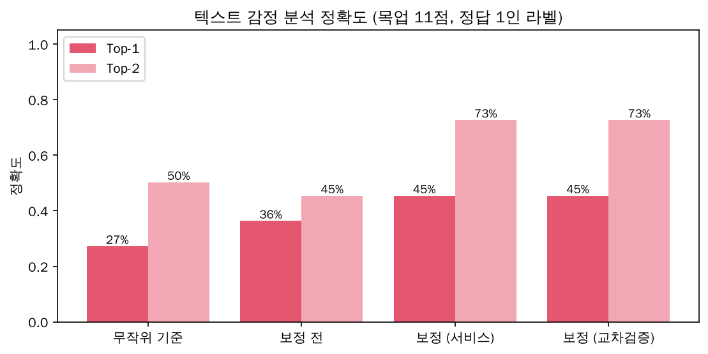
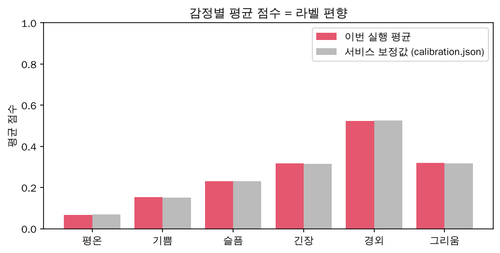
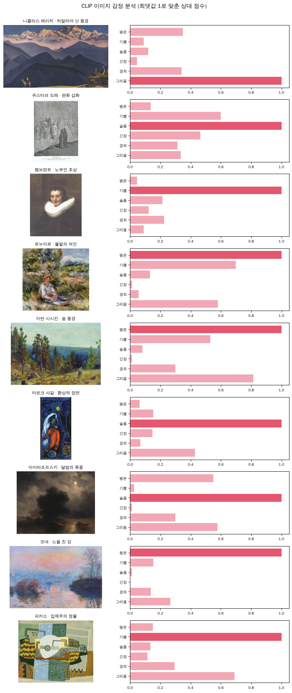
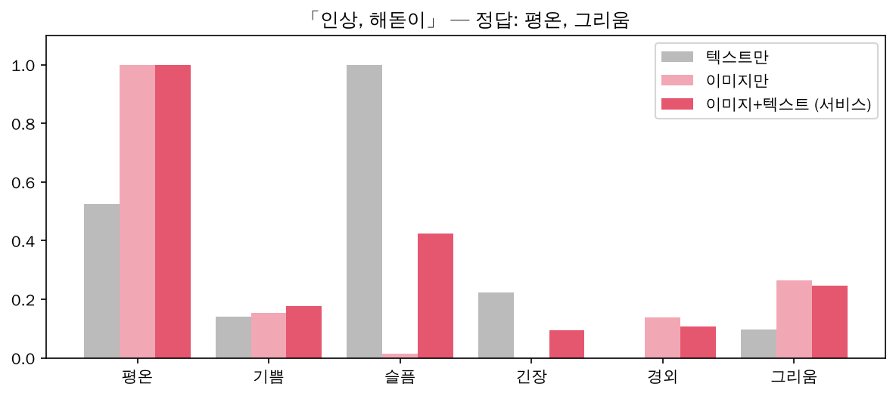

# 🧠 ARTI AI · 추천 정리 (감정 분석 → 취향 비교 → 추천)

[← 문서 안내](README.md) · [AI 서버](../ai-service/README.md) · [백엔드](../backend/README.md) · [검증 노트북](../ai-service/evaluation/ai_validation.ipynb)

> 작성: 김광권 (`dev/김광권` 구현본 기준, 2026-10-24). 발표·보고서에서 **"AI가 무엇을 하고, 무엇을 근거로 추천하며, 얼마나 맞는지"**를 설명할 때 쓰는 문서입니다.
> **확인된 사실**과 **설계 가정(임의로 정한 값)**을 구분해 적었습니다.

## 1. 한눈에 보기

```text
[관리자] 작품 등록 ─ 그림(캡처) + 미술관 해설
      │  「AI 분석」
      ▼
 ai-service (Python)        CLIP: 그림 → 감정 6칸 점수
                            mDeBERTa: 해설 → 감정 6칸 점수
                            → 편향 보정 → 이미지 60% + 텍스트 40%
      │  「AI 제안」으로 저장 → 관리자가 확인·수정 → 「확정」
      ▼
[사용자] 취향 카드 선택 ──(변환표)──▶ 사용자 감정 6칸 점수
      │
      ▼
 backend 추천:  0.7 × 감정 유사도(코사인) + 0.3 × 취향 태그 일치율
      → 관람 시간에 맞는 개수 선택 → 입구에서 가까운 순서로 동선
```

감정 6가지: **평온 · 기쁨 · 슬픔 · 긴장 · 경외 · 그리움**

## 2. 어떤 AI를 쓰나 — 파인튜닝 없는 "제로샷"

| 대상 | 모델 (오픈소스) | 하는 일 |
|---|---|---|
| 그림 | [`openai/clip-vit-base-patch32`](https://huggingface.co/openai/clip-vit-base-patch32) (CLIP, MIT) | 그림이 "a calm and peaceful painting" 같은 감정 문장과 얼마나 닮았는지 |
| 해설 | [`MoritzLaurer/mDeBERTa-v3-base-mnli-xnli`](https://huggingface.co/MoritzLaurer/mDeBERTa-v3-base-mnli-xnli) (MIT) | 해설이 "이 글이 묘사하는 작품의 분위기는 평온함이다"를 얼마나 뒷받침하는지 |
| 요약·질문·영수증 해석 | Claude API (선택, 키가 없으면 규칙 기반) | 감정 분석·추천에는 쓰지 않음 |

**우리가 한 것 / 하지 않은 것**

| | 내용 | 모델 가중치가 바뀌나 |
|---|---|---|
| ✅ | 사전학습 모델을 Hugging Face `transformers`로 불러와 그대로 사용 | 아니요 |
| ✅ | 감정 문장(프롬프트) 설계: 감정마다 영어 문장 2개(CLIP), 한국어 가설 문장(NLI) | 아니요 |
| ✅ | 라벨 편향 보정: 모델이 어떤 글에나 높게 주는 감정('경외')의 평균 점수를 빼기 | 아니요 (후처리) |
| ✅ | 모델 비교: 텍스트 모델 4종을 같은 데이터로 비교해 선택 | 아니요 |
| ❌ | **파인튜닝(미술 작품·감정 정답으로 추가 학습)** | — (향후 과제, 7장) |

## 3. 작품 감정 점수는 어떻게 만드나 (`ai-service/app/analyzer.py`)

**이미지 (CLIP)**
1. 그림을 224×224로 줄이고, 감정 문장 12개(감정마다 2개)를 토큰으로 바꿈
2. CLIP이 그림과 문장 12개 각각의 유사도(`logits_per_image`)를 계산
3. 감정마다 문장 2개의 유사도를 평균 → 6개 감정끼리 softmax → 합이 1인 분포

**텍스트 (mDeBERTa NLI)**
- 해설 + 가설 "이 글이 묘사하는 작품의 분위기는 {평온함}이다." → 감정마다 0~1 확률(여러 감정이 동시에 높을 수 있음)

**보정과 합치기**
1. **라벨 편향 보정(텍스트):** 감정별 평균 점수(`app/calibration.json`, 경외 0.53 · 평온 0.07 …)를 빼고, 가장 낮은 감정이 0이 되게 올림
2. 이미지·텍스트를 각각 합이 1이 되게 맞춘 뒤 **이미지 60% + 텍스트 40%**
3. 가장 강한 감정을 1로 맞춘 상대 점수(0~1) → 관리자 화면 막대그래프
- 이미지가 없거나 읽지 못하면 텍스트만 사용. 무작위 요소가 없어 같은 입력엔 항상 같은 결과

**사람의 검수:** 결과는 「AI 제안」으로 저장되고, 관리자가 「감정 분석 확정」을 눌러야 추천에 쓰입니다. 확정 뒤 해설이나 이미지를 바꾸면 자동으로 「AI 제안」으로 돌아갑니다.

## 4. 사용자 취향 점수는 어떻게 만드나 (`backend/src/lib/emotion.ts`)

AI를 쓰지 않습니다. 취향 카드마다 정해 둔 감정 값(**변환표 `TASTE_EMOTIONS`**)을 평균합니다.

| 취향 카드 | 평온 | 기쁨 | 슬픔 | 긴장 | 경외 | 그리움 |
|---|---|---|---|---|---|---|
| 강한 색감 | 0.1 | 0.6 | 0.1 | 0.5 | 0.4 | 0.1 |
| 고요한 풍경 | 0.9 | 0.2 | 0.1 | 0 | 0.3 | 0.5 |
| 추상적 형태 | 0.3 | 0.3 | 0.1 | 0.4 | 0.5 | 0.1 |
| 부드러운 색감 | 0.7 | 0.5 | 0.1 | 0 | 0.1 | 0.5 |
| 감정 표현 | 0 | 0.2 | 0.6 | 0.6 | 0.3 | 0.4 |
| 빛 | 0.5 | 0.7 | 0 | 0 | 0.5 | 0.2 |

**예: 「고요한 풍경」+「부드러운 색감」**
1. 칸마다 평균 → 평온 0.8 · 기쁨 0.35 · 슬픔 0.1 · 긴장 0 · 경외 0.2 · 그리움 0.5
2. 가장 큰 값(0.8)으로 나눔 → **평온 1.00 · 기쁨 0.44 · 슬픔 0.13 · 긴장 0 · 경외 0.25 · 그리움 0.63**

> ⚠️ 변환표 숫자는 **데이터로 정한 값이 아니라 개발자가 정한 설계 가정**입니다. 관람 중 누른 👍/👎는 아직 이 점수에 반영되지 않습니다.

## 5. 추천 알고리즘 (`backend/src/lib/recommend.ts`)

```text
입력: 사용자 카드 T_user, 관람 시간
후보 ← 검수 완료(approved) + 지도 위치가 있는 작품
for 작품 w in 후보:
    M        ← w.태그 ∩ T_user                         # 겹치는 취향 태그
    tagScore ← |M| / |T_user|                          # 사용자 카드 중 몇 %가 작품에 있나
    if w의 감정 분석이 「확정」:
        sim   ← cosine(사용자 감정 점수, w 감정 점수)
        score ← 0.7 × sim + 0.3 × tagScore
    else:
        score ← tagScore                               # AI 분석이 없으면 태그만
상위 N개 선택 (30분 3점 · 1시간 5점 · 여유롭게 7점, 동점은 작품 ID 순)
관람 순서 ← 입구에서 출발해 가장 가까운 작품을 차례로 (최근접 이웃)
추천 이유 ← 함께 강한 감정("평온 · 그리움의 분위기") / 없으면 겹친 태그 / 없으면 "새로운 취향을 넓혀 줄 작품"
```

**코사인 유사도:** 두 감정 점수표의 **비율이 얼마나 비슷한지**(0~1). 크기가 아니라 방향을 비교합니다.

**계산 예시** (사용자: 고요한 풍경 + 부드러운 색감 / 작품: 수련, 태그 = 고요한 풍경·빛·부드러운 색감)

| 단계 | 값 |
|---|---|
| 태그 일치율 | 겹침 2개 ÷ 고른 카드 2개 = **1.0** |
| 수련 감정 점수 (해설만 분석) | 평온 0.36 · 기쁨 0.74 · 슬픔 0.10 · 긴장 0 · 경외 1.00 · 그리움 0.11 |
| 감정 유사도 | 사용자는 평온·그리움, 수련은 경외·기쁨 → 약 **0.60** |
| 최종 점수 | 0.7 × 0.60 + 0.3 × 1.0 ≈ **0.72** |

### 요약 키워드 vs 취향 태그
| | 요약 키워드 (`#연못` `#빛`) | 취향 태그 (6종) |
|---|---|---|
| 만드는 쪽 | Claude가 해설에서 뽑거나 관리자가 입력 | 관리자가 A-04에서 선택 |
| 쓰임 | U-10 해설 탭에 **표시만** (인스타 해시태그처럼) | **추천 점수**(30%)와 추천 이유 |

## 6. 임의로 정한 값 (근거를 만들어야 할 것)

| 값 | 현재 | 근거 만들기 |
|---|---|---|
| 목업 작품 12점의 취향 태그 | 개발자가 그림을 떠올리며 붙인 예시 | 실제 전시 작품으로 바꾸며 팀원 2~3명이 각자 붙이고 다수결 |
| 취향 카드 → 감정 변환표 | 개발자 가정 | 설문: "이 카드를 고르는 사람은 어떤 분위기를 좋아할까?" 평균 |
| 감정 70% / 태그 30% | 임의 | 👍/👎 반응 데이터로 비율별 만족도 비교 |
| 이미지 60% / 텍스트 40% | 임의 | 팀 라벨로 이미지·텍스트·결합 정확도 비교 (노트북) |
| 감정 문장(프롬프트) | 개발자 작성 | 문장 후보를 바꿔 가며 노트북으로 정확도 비교 |
| 평가 정답 11점 | 개발자 1인 판단 | 팀원 각자 라벨 → `evaluation/team_labels.csv` |

## 7. 얼마나 맞나 — 검증 결과 ([노트북](../ai-service/evaluation/ai_validation.ipynb))

**텍스트 분석 정확도** (목업 11점, 정답 1인 라벨)



| 방식 | Top-1 | Top-2 |
|---|---|---|
| 무작위 기준 | 27% | 50% |
| 보정 전 | 36% | 45% |
| **보정 후 (서비스)** | **45%** | **73%** |
| 보정 후 (교차검증: 평가 작품을 빼고 보정값 계산) | 45% | 73% |

**라벨 편향** — 모델은 어떤 해설에나 '경외'를 높게 줍니다(평균 0.52, 평온은 0.07).



**이미지(CLIP) 정성 확인** — WikiArt 9점, 정답 없이 눈으로 확인 (풍경·밝은 그림은 자연스럽고, 어두운 그림·초상은 어색)



**이미지 + 텍스트 결합** — 「인상, 해돋이」: 텍스트만이면 1위 '슬픔'(오답), 이미지를 합치면 '평온'(정답)



**발견한 점**
- 정답이 '기쁨'인 4점은 하나도 1위로 맞히지 못했다(텍스트). 칸딘스키 「구성 VIII」을 '평온'으로 오인.
- 이 오류 때문에 '고요한 풍경 + 부드러운 색감' 사용자에게 「구성 VIII」이 감정 유사도 1위로 나온다 → **AI 오류는 추천으로 전파되므로 관리자 확정 단계가 필요**하다.
- 검증 중 보정 코드의 문제(모든 감정이 평균보다 낮으면 보정 전 점수로 돌아감)를 발견해 고쳤다. 서비스 방식 정확도 36%/64% → 45%/73%.

**한계:** 작품 11점·정답 1인 → 한 작품에 9%p씩 움직임 / 유명 서양화 목업(실제 전시인 유영국 추상화와 다름) / 이미지 정확도는 측정하지 않음.

## 8. 개선 방향

| 우선순위 | 할 일 | 난이도 |
|---|---|---|
| 1 | 실제 전시 작품 20~30점 + 캡처 이미지 + **팀원 각자 라벨** → 노트북 10장(일치도·다수결 정확도) | 낮음 |
| 2 | 변환표를 설문으로 보정 | 낮음 |
| 3 | 👍 누른 작품의 감정을 사용자 점수에 섞기 (관람할수록 정확해지는 추천, 밴딧 강화학습의 첫 단계) | 중간 |
| 4 | **CLIP 리니어 프로브**: 모델은 고정하고 마지막 분류기만 팀 라벨로 학습 (CPU 가능) | 중간 |
| 5 | ArtEmis(WikiArt 8만 점 + 사람이 느낀 감정)로 CLIP 파인튜닝 (GPU·데이터 이용 조건 확인) | 높음 |

## 9. 발표용 설명과 예상 질문

> "작품 그림과 해설을 오픈소스 모델(CLIP, mDeBERTa)로 **추가 학습 없이(제로샷)** 감정 6차원 벡터로 만들고, 사용자 취향도 같은 6차원으로 표현해 **코사인 유사도**로 추천합니다. 모델의 라벨 편향은 평균 점수 보정으로 줄였고, AI 결과는 관리자가 검수한 뒤에만 서비스에 반영합니다."

| 질문 | 답 |
|---|---|
| AI를 직접 학습시켰나? | 아니요. 사전학습 모델을 제로샷으로 쓰고, 프롬프트 설계·편향 보정·모델 비교로 성능을 높였습니다. 파인튜닝은 라벨을 모은 뒤의 과제입니다. |
| 정확도는? | 텍스트 기준 Top-1 45%, Top-2 73% (무작위 27%·50%). 11점·1인 라벨이라 경향 수준이고, 팀 라벨과 실제 작품으로 다시 측정할 예정입니다. |
| AI가 틀리면? | 결과는 「AI 제안」으로만 저장되고 관리자가 확인·수정·확정해야 추천에 쓰입니다. 분석이 없는 작품은 취향 태그로 추천합니다. |
| 사용자 취향은 어떻게 감정이 되나? | 취향 카드별 감정 값 표를 평균합니다. 현재는 설계 가정이며 설문으로 보정할 계획입니다. |
| 왜 이미지와 텍스트를 같이 쓰나? | 텍스트 모델은 '경외' 쏠림이 있고, 그림을 보면 보완되는 경우가 있었습니다(「인상, 해돋이」 사례). |
