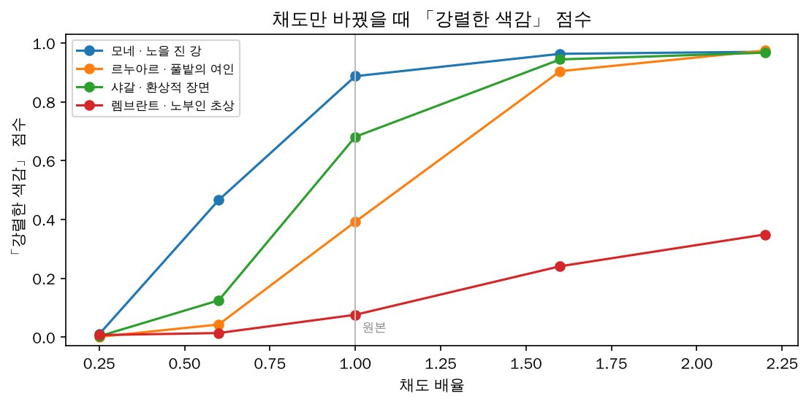
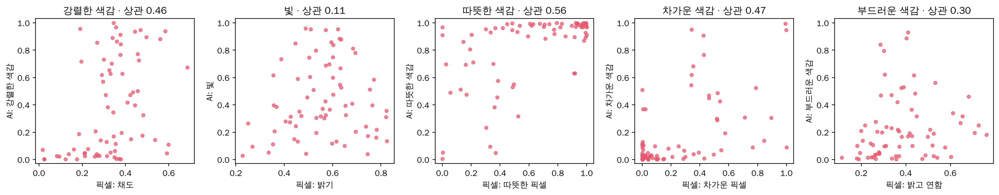

# 🧠 ARTI AI · 추천 정리 (취향 태그 → 추천, 감정 → 설명)

[← 문서 안내](README.md) · [AI 서버](../ai-service/README.md) · [백엔드](../backend/README.md) · [검증 노트북](../ai-service/evaluation/ai_validation.ipynb) · [결정 과정 (A·B·C 대안)](추천-기준-통일-대안.md)

> 작성: 김광권 (`dev/김광권` 구현본 기준, 2026-10-27). 발표·보고서에서 **"AI가 무엇을 하고, 무엇을 근거로 추천하며, 얼마나 맞는지"**를 설명할 때 쓰는 문서입니다.
> **확인된 사실**과 **임의로 정한 값**을 구분해 적었습니다.

## 1. 한눈에 보기

```text
[관리자] 작품 등록 ─ 그림(캡처) + 미술관 해설
      │  「AI 분석」
      ▼
 ai-service (Python)   CLIP: 그림 → 취향 태그 8개 점수 (0~1, 태그마다 독립)   ← 추천에 사용
                       CLIP + mDeBERTa: 그림·해설 → 감정 6개 점수            ← 설명에만 사용
      │  「AI 제안」 → 관리자가 태그 버튼을 고치고 「태그 확정」
      ▼
[사용자] 취향 카드 선택 (같은 8개 단어)
      │
      ▼
 backend 추천:  점수 = 고른 카드의 태그 점수 평균
      → 카드마다 최소 1점 + 점수순으로 관람 시간에 맞는 개수 → 입구에서 가까운 순서로 동선
```

**취향 태그 8개** = 사용자 취향 카드 = 관리자 태그 = AI 태그 (같은 단어, 변환표 없음)

| 소재·형태 | 빛 | 색 |
|---|---|---|
| 풍경 · 인물 · 추상 | 빛 | 강렬한 색감 · 차가운 색감 · 따뜻한 색감 · 부드러운 색감 |

**감정 6개** (평온 · 기쁨 · 슬픔 · 긴장 · 경외 · 그리움) — 작품 분위기 설명(U-10)과 아트 영수증(U-12)에만 씁니다.

> 예전에는 감정으로 추천하고, 취향 카드를 감정으로 바꾸는 **개발자가 정한 변환표**로 둘을 이었습니다. 근거가 약해 **태그로 통일**했습니다([결정 과정](추천-기준-통일-대안.md)).

## 2. 어떤 AI를 쓰나 — 파인튜닝 없는 "제로샷"

| 대상 | 모델 (오픈소스) | 하는 일 |
|---|---|---|
| 그림 | [`openai/clip-vit-base-patch32`](https://huggingface.co/openai/clip-vit-base-patch32) (CLIP, MIT) | **태그:** "해당하는 그림" 문장과 "해당하지 않는 그림" 문장 중 어느 쪽에 가까운지 / **감정:** 감정 문장과의 유사도 |
| 해설 | [`MoritzLaurer/mDeBERTa-v3-base-mnli-xnli`](https://huggingface.co/MoritzLaurer/mDeBERTa-v3-base-mnli-xnli) (MIT) | **감정:** 해설이 "작품의 분위기는 평온함이다"를 뒷받침하는 정도 / **태그:** 그림이 없을 때만 (참고용) |
| 요약·질문·영수증 해석 | Claude API (선택, 키가 없으면 규칙 기반) | 감정 분석·추천에는 쓰지 않음 |

| | 내용 | 모델 가중치가 바뀌나 |
|---|---|---|
| ✅ | 사전학습 모델을 Hugging Face `transformers`로 불러와 그대로 사용 | 아니요 |
| ✅ | 태그·감정 문장(프롬프트) 설계 (「강렬한 색감」은 채도 조절 실험으로 골랐음) | 아니요 |
| ✅ | 감정 라벨 편향 보정 ('경외' 쏠림) | 아니요 (후처리) |
| ✅ | 모델 비교 (텍스트 모델 4종) | 아니요 |
| ❌ | **파인튜닝** (작품 + 정답으로 추가 학습) | — 향후 과제 (8장) |

## 3. 작품 태그 점수는 어떻게 만드나 (`ai-service/app/tags.py`, `analyzer.py`)

태그마다 영어 문장 두 묶음이 있습니다. 예) 풍경: "a landscape painting of nature" vs "a portrait or figure painting"

1. CLIP이 그림과 각 문장의 유사도를 계산
2. 태그마다 (해당하는 문장 평균 − 해당하지 않는 문장 평균) → 시그모이드 → **0~1**
3. 태그마다 따로 판단하므로 한 그림이 '풍경'이면서 '빛'이면서 '따뜻한 색감'일 수 있음
4. **0.5 이상 = "해당함"** → 관리자 화면에서 태그 버튼이 미리 켜짐
- 그림이 있으면 그림으로만 판단, 없으면 해설로 판단(색은 글로 판단하기 어려워 참고용)

## 4. 관리자 태그와 AI 태그의 관계 (`backend/src/lib/tags.ts`)

AI가 초안을 쓰고, 관리자가 고쳐서 확정합니다.

```text
「AI 분석」 → 태그 버튼마다 AI 점수 표시 (풍경 0.87, 빛 0.98 …) + 「AI 제안」
          → 「AI 제안대로 켜기」 → 관리자가 켜고/끄고 → 「태그 확정」 → 확정 점수 저장 (서버 계산)
```

| 상황 | 추천에 쓰이는 태그 강도 |
|---|---|
| AI 태그 확정 + 관리자가 그대로 둔 태그 | AI 점수 (예: 빛 0.98) |
| AI 태그 확정 + 관리자가 **켠** 태그 (AI는 0.5 미만) | 1.0 |
| AI 태그 확정 + 관리자가 **끈** 태그 (AI는 0.5 이상) | 0 |
| AI 분석 전이거나 확정 전 | 관리자가 켠 태그 1.0, 나머지 0 |

해설이나 그림을 바꾸면 확정이 풀려 「AI 제안」으로 돌아갑니다(다시 확인 필요).

## 5. 추천 알고리즘 (`backend/src/lib/recommend.ts`)

```text
입력: 사용자 카드 T (예: 풍경, 빛), 관람 시간
후보 ← 검수 완료(approved) + 지도 위치가 있는 작품
for 작품 w in 후보:
    score(w) ← 평균( 태그강도(w, t) for t in T )          # 같은 단어끼리 바로 비교
N ← 30분 3점 · 1시간 5점 · 여유롭게 7점
먼저: 카드 t마다 태그강도(w, t) ≥ 0.5 인 작품 중 점수 1등을 1점씩   # 한 취향이 독차지하지 않게
나머지: 점수순으로 N개가 될 때까지 (동점은 작품 ID 순)
관람 순서 ← 입구에서 출발해 가장 가까운 작품을 차례로
추천 이유 ← 고른 카드 중 이 작품에 해당하는(0.5 이상) 태그: "풍경 · 빛"
```

**예시** (사용자: 「풍경」+「빛」)

| 작품 상태 | 태그 강도 | 점수 |
|---|---|---|
| 모네 노을: AI 확정 | 풍경 0.87, 빛 0.98 | (0.87 + 0.98) ÷ 2 = **0.93** |
| 확정 전, 관리자가 「풍경」만 켬 | 풍경 1.0, 빛 0 | **0.50** |
| AI 없이 관리자가 둘 다 켬 | 풍경 1.0, 빛 1.0 | **1.00** |
| 아무것도 없음 | 0, 0 | **0** |

- 어떤 경우든 **계산식이 하나**(고른 카드의 태그 강도 평균)이고, 강도의 출처만 다릅니다.
- 관리자가 직접 켠 태그(1.0)는 AI 점수보다 높아, 사람이 확인한 작품이 약간 유리합니다(의도된 우선순위).

### 요약 키워드 vs 취향 태그
| | 요약 키워드 (`#연못` `#빛`) | 취향 태그 (8개) |
|---|---|---|
| 만드는 쪽 | Claude가 해설에서 뽑거나 관리자가 입력 | AI가 제안 → 관리자 확정 |
| 쓰임 | U-10 해설 탭에 **표시만** | **추천 점수**와 추천 이유 |

## 6. 임의로 정한 값 (근거를 만들어야 할 것)

| 값 | 현재 | 근거 만들기 |
|---|---|---|
| 태그 "해당함" 기준 0.5 | 임의 | 캡처 40점(노트북 1-8)으로 태그별 기준값 조정 |
| 태그·감정 문장(프롬프트) | 개발자 작성 (강렬한 색감만 실험으로 선택) | 문장 후보를 바꿔 노트북으로 비교 |
| 목업 작품 12점의 태그 | 개발자가 그림을 떠올리며 붙인 예시 | 실제 전시 작품으로 바꾸며 AI 제안 → 관리자 확정 |
| 감정 이미지 60% / 텍스트 40% | 임의 (설명용이라 영향 작음) | 팀 라벨로 비교 |
| 평가 정답 (감정 11점, 캡처 40점 태그) | 개발자 1인 판단 | 팀원 각자 라벨 → 다수결 |

> 예전 방식의 **취향 카드 → 감정 변환표**와 **감정 70% / 태그 30% 비율**은 태그 통일로 없어졌습니다.

## 7. 얼마나 맞나 — 검증 결과 ([노트북](../ai-service/evaluation/ai_validation.ipynb))

### 태그 (추천에 사용) — WikiArt 70점
**풍경·인물은 데이터셋의 공식 장르 정답**(풍경화·초상화·정물화)으로 검증해, 개발자가 정한 정답보다 근거가 강합니다.

| 태그 | 결과 |
|---|---|
| 풍경 | 정확도 **96%** · AUC 1.00 (55점) |
| 인물 | 정확도 **91%** · AUC 0.98 (정밀도 80% — 사람이 작게 들어간 풍경화·정물화를 인물로 봄) |
| 추상 | 입체주의 평균 0.44 vs 그 외 0.19 (경향만 확인, 진짜 추상화가 거의 없는 데이터) |
| 색 태그 ↔ 픽셀 측정값 순위 상관 | 따뜻한 0.56 · 차가운 0.47 · 강렬한 0.46 · 부드러운 0.30 |
| 빛 ↔ 평균 밝기 | 0.11 — **가장 불확실** ('빛'은 밝기가 아니라 광원·광채 느낌이라 픽셀로 검증하기 어려움) |


**채도 조절 실험** — 같은 그림의 채도만 바꾸면 「강렬한 색감」 점수가 따라 올라갑니다 → 소재가 아니라 색을 보고 판단.





**알아 둘 점**
- 따뜻한/차가운 색감은 같은 문장 쌍을 반대로 쓰는 구조라 모든 그림이 둘 중 한쪽으로 기웁니다. 이 샘플은 픽셀로 재도 74%가 따뜻한 색 우세(옛 유화)라 AI도 86%를 따뜻한 색감으로 봤습니다. "중립 색" 문장을 더한 대안은 픽셀과의 일치가 더 낮아 현행을 유지했습니다.
- 캡처한 40점(태그마다 5점, `evaluation/tag_eval_set.json`)을 `evaluation/images/01.png ~ 40.png`로 넣고 노트북 1-8을 실행하면 실제 사용 환경에 가까운 정확도가 나옵니다.

### 감정 (설명용) — 목업 11점, 정답 1인 라벨
| 방식 | Top-1 | Top-2 |
|---|---|---|
| 무작위 기준 | 27% | 50% |
| 보정 후 (서비스) | 45% | 73% |

'경외' 쏠림이 있고 정답이 '기쁨'인 작품을 못 맞혀서 추천에는 쓰지 않고 설명에만 씁니다. 태그(풍경 96%)와 비교하면 **추천 기준을 태그로 바꾼 근거**가 됩니다.

## 8. 개선 방향

| 우선순위 | 할 일 | 난이도 |
|---|---|---|
| 1 | 캡처 40점 정확도 측정 → 태그별 기준값(0.5) 조정 | 낮음 |
| 2 | 실제 전시(유영국) 작품 + 팀원 각자 라벨 → 다수결 정답으로 재측정 | 낮음 |
| 3 | 👍 누른 작품의 태그를 사용자 취향에 섞기 (관람할수록 정확해지는 추천, 밴딧 강화학습의 첫 단계) | 중간 |
| 4 | **CLIP 리니어 프로브**: 모델은 고정하고 태그별 작은 분류기만 팀 라벨로 학습 (CPU 가능) | 중간 |
| 5 | 「빛」 태그 문장 개선 또는 관리자 수동 지정으로 전환 | 낮음 |

## 9. 발표용 설명과 예상 질문

> "사용자 취향 카드, 관리자 태그, AI 태그를 **같은 8개 단어**(풍경·인물·추상·빛·색감 4종)로 통일했습니다. CLIP이 **추가 학습 없이(제로샷)** 그림마다 태그 점수를 매겨 제안하고, 관리자가 확인해 확정하면, 사용자가 고른 카드의 태그 점수 평균으로 추천합니다. 풍경·인물 태그는 WikiArt 장르 정답 기준 96%·91%로 검증했습니다."

| 질문 | 답 |
|---|---|
| AI를 직접 학습시켰나? | 아니요. 사전학습 CLIP을 제로샷으로 쓰고 문장 설계·검증으로 성능을 확인했습니다. 파인튜닝(리니어 프로브)은 라벨을 모은 뒤의 과제입니다. |
| 정확도는? | 풍경 96%, 인물 91%(WikiArt 장르 정답). 색 태그는 픽셀 색과 중간 정도(0.46~0.56) 일치, '빛'은 가장 불확실해 관리자 확인을 둡니다. |
| 왜 감정으로 추천하지 않나? | 감정은 정답 자체가 사람마다 다르고 정확도도 45%라, 겉모습 태그로 추천하고 감정은 작품 분위기 설명에만 씁니다. 취향 카드를 감정으로 바꾸는 임의의 변환표도 필요 없어졌습니다. |
| AI가 틀리면? | 「AI 제안」만 하고 관리자가 태그를 고쳐 확정합니다. 고친 태그는 1 또는 0으로 AI보다 우선합니다. AI 서버가 없어도 관리자 태그로 추천됩니다. |
| 반대 취향(따뜻한+차가운)을 고르면? | 카드마다 그 태그가 있는 작품을 최소 1점씩 넣어 두 취향이 모두 반영됩니다. |
