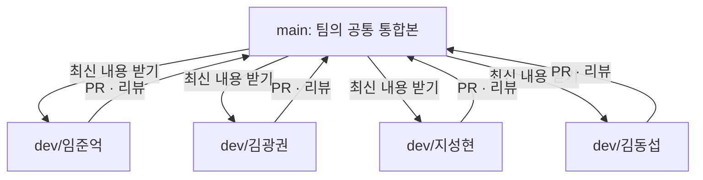

# 🌱 그림으로 보는 ARTI GitHub 협업 흐름

[← 메인 안내로](../README.md)

## 1. 브랜치를 왜 나눌까요?

**같은 프로젝트 파일을 여러 명이 동시에 수정해도, 각자 작업하다가 변경 사항을 확인하고 합치기 위해서**입니다.



각자의 브랜치에는 **전체 저장소가 그대로 포함**되어 있습니다. `dev/김광권`이라고 해서 프론트엔드 파일만 들어가는 것은 아닙니다.

## 2. 한 번의 작업이 합쳐지는 과정

```text
[1] 작업 확인 (Issue / Notion)
    ↓
[2] 내 dev/이름 브랜치 선택
    ↓
[3] 최신 main 반영
    ↓
[4] 코드 작성 + 직접 실행·검증
    ↓
[5] 커밋: feat: 작품 추천 화면 구현
    ↓
[6] 개인 브랜치에 push
    ↓
[7] PR 생성: 내 dev/이름 → main
    ↓
[8] 검토·필요시 수정
    ↓
[9] main 병합
    ↓
[10] 다음 작업 전 내 브랜치에 최신 main 반영
```

## 3. 예시 — 지성현 팀원이 작품 추천 화면을 만든다면

1. `dev/지성현`에서 추천 화면 개발
2. `feat: 작품 추천 결과 화면 구현`으로 커밋
3. PR 제목 `feat: 작품 추천 결과 화면 구현`
4. 다른 팀원이 테스트 결과·화면·API 필드를 확인
5. PR이 병합되면 `main`에서 팀 모두 최신 화면을 이용 가능

**코드를 병합한다고 자동 배포되는 것은 아닙니다.** CI/CD 및 배포는 별도 설정이 필요합니다.

## 4. 사람들이 자주 헷갈리는 것

| 질문 | 답 |
| --- | --- |
| `main`에서 바로 코딩해도 되나요? | 팀 규칙상 **아니요.** 개인 브랜치에서 작업 후 PR로 합칩니다. |
| 개인 브랜치를 또 만들어야 하나요? | **아니요.** 네 명의 `dev/이름` 브랜치를 미리 만들었습니다. |
| 다른 팀원의 코드를 어디서 볼 수 있나요? | `main`에 병합된 부분은 모두가 볼 수 있습니다. 병합 전에는 해당 팀원 브랜치에서 확인할 수 있습니다. |
| 개인 브랜치도 `main`처럼 최신인가요? | 처음 만들 때만 같습니다. 그 뒤 `main`이 바뀌면 최신 내용을 직접 반영해야 합니다. |
| 어떤 PR 병합 방식을 쓰나요? | 장기 개인 브랜치 재사용이므로 초기에는 **Create a merge commit**을 권장합니다. |
| PR 내용에 이전 작업이 또 보이면? | 병합 방법·브랜치 동기화를 확인합니다. 무작정 강제 푸시하지 않습니다. |

## 5. 다음에 할 일
[팀원 시작 가이드](TEAM_ONBOARDING.md)에서 실제 명령어를 따라 시작하세요. [협업 규칙](CONTRIBUTING.md)에 커밋 메시지와 PR 작성 원칙이 있습니다.
