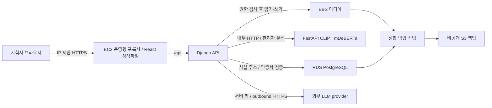

# W12 운영 구성·예산 결정안

2026-11-09 KST / 기준d43f812. **기술·비용 비교안의 준비 완료이며 AWS 운영 확정/배포 승인은 아니다.** 사용자 회신으로 크레딧 없음은 확인했고, 계정·담당·총비용 상한·종료일은 아직 미확인이다. AWS 또는 대응책과 설정 안내를 추가 조사했다. 원격 계정 조회·리소스 생성·비밀값 읽기·푸시는 하지 않았다. [기계 판독 결정안](../execution-plan/2026-11-07/records/W12/2026-11-09/decision.json), [단가와 계산](../execution-plan/2026-11-07/records/W12/2026-11-09/README.md).

## 추천과 선택 조건

**크레딧이 없는 소규모 졸업프로젝트 조건에서는 C안(Lightsail4GB + 자체 PostgreSQL)을 비용 우선 후보로 추가한다.** 관리형 DB 운영 경험/분리가 필요하고 예산을 확보하면 B안(EC2 + RDS)이 더 적합할 수 있다. 두 안 모두 기존 Django/DRF·PostgreSQL·React·FastAPI를 유지한다. RDS는 기존 계획에서도 후보였으므로 Lightsail의 PostgreSQL이 AWS 사용 자체를 벗어나는 것은 아니다. 다만 자체 DB/백업·호스트 장애·배포 인증의 부담까지 비교해야 한다. 실제 선택은 미정이다.

| 대안 | 고정 핵심 소계 가정 | 적합한 상황·남는 제약 |
| --- | --- | --- |
| C: 일반 Lightsail Linux public IPv4 4GB | 월24달러 번들 + S3 백업5GB 약0.13달러 = **24.13달러** | 비용 예측이 쉽고 같은 앱 재사용. 자체PG·호스트 복원·SSH/배포/백업 인증은 직접 준비 |
| A: EC2 + 자체PG | 월44.81달러 | EC2 역할·SSM 경로를 사용하면서 DB를 직접 운영 |
| B: EC2 + RDS | 월65.43달러 | DB 분리/관리형 기능. Single-AZ와 단일EC2는 전체 고가용성이 아님 |
| 교내 로컬/LAN 보조 시연 | 보유 장비라면 새 호스팅 청구 없음 | 전원/절전·교내 Wi-Fi 기기간 격리·방화벽·인터넷·다기기 점검 필요. 외부 LLM 비용은 남고 AWS 인수 게이트를 대체하지 않음 |

C는2vCPU/4GB RAM/80GB SSD·publicIPv4 포함 일반 VM 번들이다. **컴퓨팅·IP·기본디스크를 EC2 단가로 다시 더하지 않는다.**4TB 전송 표기는 지역별 조건/초과 요금을 확인해야 하며 무제한 전송이 아니다. 무료 체험은 계산에 넣지 않았다. [공식 번들](https://docs.aws.amazon.com/lightsail/latest/userguide/amazon-lightsail-bundles.html), [지역/요금](https://aws.amazon.com/lightsail/pricing/).

C의 번들은 시간당 과금/월 상한 방식이며 이 산정은 월 상한24달러를 사용했다. 한 달 보유하면서 실행 시간만176시간으로 줄여도 stop 시간에 과금되므로 같은 보유시간의 소계가 줄지 않는다. 인스턴스 삭제 전 백업/새 대상 복원과 소유자 확인이 필요하고 snapshot·분리IP·백업 과금은 남을 수 있다. 아래 A/B의 활성176시간 계산을 C에 적용하지 않는다. [일반 Lightsail 과금 FAQ](https://aws.amazon.com/lightsail/faq/).

### C를 선택할 때 확인할 설정 순서

1. 실제 AWS 계정/결제수단·사용 담당·총상한/종료일을 정하고 MFA/알림을 준비한다. 계정 약관/결제 설정을 이번 조사에서 대신 수행하지 않았다. 서울의 실제 제공 bundle/Ubuntu LTS x86 blueprint를 콘솔 또는 read-only API로 확인한 뒤 크기를 선택한다.
2. 일반 VM 번들로 구성하고, 다른 Lightsail container/managed database/Research 상품의 가격·제약을 혼동하지 않는다. attached static IPv4와 도메인/DNS·HTTPS 발급/갱신을 정한다. 기본 동적IP는 stop/start에 바뀔 수 있다. [static IP](https://docs.aws.amazon.com/lightsail/latest/userguide/lightsail-create-static-ip.html).
3. Lightsail 방화벽과 호스트에서443은 시험자,22는 운영자 접속 경로로 제한하고 IPv6도 같은 기준으로 닫거나 제한한다. API/DB/모델 내부 포트는 외부에 열지 않는다. 운영형 proxy/static → Django → 내부DB/모델 구조로 구성한다.
4. 앱 환경은 production/debug=false/fixture=false, 실제 host·동일origin `/api`, 강한 secret·별도 DB 계정, 내부 모델 주소/캐시/revision·writer=false를 준비한다. 파일/DB는 영속 경로와 UID10001을 확인한다. DB 통신/디스크/백업의 암호화·CA·키 보존은 AC23/26에 맞춰 확인하며 저가 VM이라는 이유로 생략하지 않는다. 번들 루트디스크는 인스턴스 삭제와 함께 잃을 수 있으므로 단순 볼륨 이름만으로 새 VM 복구가 보장된다고 하지 않는다.
5. EC2 instance profile/SSM 배포를 Lightsail에 그대로 복사하지 않는다. 우선 운영자의 임시 AWS 자격으로 오프호스트 정합 백업을 보관하는 안을 사용하고, VM에 장기 AWS키를 넣는 방식을 기본으로 두지 않는다. CD는 이후 GitHub OIDC의 제한된 Lightsail API 권한·임시 SSH 키/host key 검증·runner 접속망을 별도 검증한다. API가 임시키를 제공한다는 사실만으로 CD가 구현됐다는 뜻은 아니다. [임시 SSH API](https://docs.aws.amazon.com/lightsail/2016-11-28/api-reference/API_GetInstanceAccessDetails.html).
6. 먼저 합성자료로1대에서 기동/권한/모델/백업·새 VM 복원·종료 비용을 확인한다. 실제 유영국 인수와 프론트/DB 범위를 유지하고 크기 부족은 부하 측정 후 조정한다. 교내 로컬 시연도 함께 준비하면 네트워크 장애에 대응할 수 있으나 AWS 수행/미수행은 발표에서 분리한다.

아래는 EC2의 A/B 대안과 RDS 선택 시 필요한 상세 비교다. 비용을 더 낮춰야 한다면 짧은 AWS 시험 기간과 로컬 보조 시연을 조합할 수 있지만, 삭제/보존·재기동/복원 실제 비용을 다시 계산하고 AWS 요구 범위 변경은 별도로 확정한다.

| 항목 | A: 최소 시험 구성 | B: 우선 검토 구성 |
| --- | --- | --- |
| API·정적 프론트 | 서울 EC2 x86 t3.medium(2vCPU/4GiB) 후보, 운영형 proxy/static + Django | 동일 |
| DB | EC2 내부 PostgreSQL17·별도 영속 데이터 경로 | 비공개 RDS PostgreSQL17 계열·db.t4g.micro(1GiB)·Single-AZ·gp3 20GiB 후보 |
| 모델 | 같은 EC2의 별도 FastAPI 프로세스/컨테이너·1 worker·Kanana writer 비활성 | 동일. DB가 분리돼도 API/모델 자원 경쟁은 남음 |
| 파일 | 암호화 EBS 영속 미디어 + 별도 비공개 S3 백업 | 동일. S3를 앱의 직접 파일 저장소로 전환하지 않는1차안 |
| 장점 | 새 DB 외부 연결 작업과 고정비가 작음 | DB 운영/복구 기능을 활용하고 API 재배포와 DB 수명을 분리 |
| 부담 | DB 패치·백업·장애 복구를 직접 담당, 한 호스트 장애에 집중 | 비용 증가·VPC/CA/TLS·접속/복원 검증 필요 |
| 선택 조건 | 담당자가 자체 DB 복구를 재현하고 비용/중단 위험을 수용 | 계정/상한·RDS 권한/지원 버전 확인과 실제 복구 시험 |

EC2 4GiB는 **측정할 후보**다. 기존 모델 단독 peak RSS 약1261MiB는 호스트 전체 용량이 아니고, CPU4스레드 로컬 결과를 EC2 2vCPU 성능으로 복사할 수 없다. 모델·Django·OS·이미지 빌드/재배포를 함께 측정해 OOM/스왑/응답 지연이 생기면 구성/동시성부터 재검토한다. t3.large는 메모리8GiB지만 같은2vCPU이므로 빠른 추론을 보장하지 않는다. 앱 x86 이미지를 ARM으로 전환하는 작업은 초기 범위에서 제외한다. RDS의 Graviton은 별도 DB 서버이므로 앱 바이너리를 ARM으로 바꾸라는 뜻이 아니다.

관람객 추천은 저장·검수된 점수를 사용한다. CLIP/mDeBERTa는 관리자 분석에만 기동하고 관람객마다 재추론하지 않는다. 모델을 꺼도 검수된 전시 조회/추천은 가능해야 하며 신규 분석은503으로 명확히 안내한다. GPT 도슨트는 외부 호환 provider 경로를 유지하고 사용 모델/요금/하네스 확장은 기존 별도 논의로 남긴다. 기본 GPU·Kubernetes·ALB·NAT Gateway·벡터DB를 추가하지 않는다.

EBS40GiB는 루트/데이터 합계의 비용 가정이다. 실제 분할을 정한 뒤 데이터 볼륨은 호스트 수명과 분리하고 DeleteOnTermination=false·고정 mount·소유권을 검증한다. 컨테이너 재생성 성공과 EC2 교체 후 복원 성공은 별개다. 보존 백업보다 암호화 키를 먼저 폐기하지 않는다.

## 비용: 핵심 항목 소계이며 청구액/상한이 아님

서울·Linux shared On-Demand, 할인/무료 크레딧 미적용.30일720시간, EC2 t3.medium1대, 유지 공인IPv4 1개, EBS40GiB, S3 Standard 백업 평균5GB, B의 RDS20GiB를 가정했다. 원화는 환율·세금이 달라 환산하지 않았다. 단가의 SKU/조건/발행일은 [pricebook.json](../execution-plan/2026-11-07/records/W12/2026-11-09/pricebook.json)에 고정했다.

| 계산용 항목 | 단가/조건 | A·B 공통30일 |
| --- | --- | --- |
| EC2 t3.medium | USD0.052/시간 | 37.44달러 |
| 유지 공인IPv4 | USD0.005/시간, 사용/유휴 모두 과금 | 3.60달러 |
| EBS gp3 40GiB | USD0.0912/GB-month | 약3.65달러 |
| S3 Standard 백업5GB | USD0.025/GB-month, 첫 구간 | 약0.13달러 |
| B의 RDS 인스턴스 | db.t4g.micro USD0.025/시간 | 추가18.00달러 |
| B의 RDS gp3 20GiB | USD0.131/GB-month | 추가2.62달러 |

| 운영 가정 | A 핵심 소계 | B 핵심 소계 |
| --- | --- | --- |
| 720시간 상시 | **44.81달러** | **65.43달러** |
| 계산상176시간(8시간×22일) | 16.53달러 | 23.55달러 |
| 새 Route53 zone 사용 시 | 위 금액에0.50달러 추가 | 동일 |

각 항목 표시를 반올림하므로 표시값의 합과 소계가0.01달러 다를 수 있다. 소계는 원단가로 계산한 후 반올림했다.176시간은 **스케줄 구현/실제 청구 검증이 없는 비교 시나리오**다. EC2/RDS 시작·정지 시간과 RDS의 최대7일 정지 후 자동 재시작을 반영해야 한다. 정지 중에도 보존 스토리지·유지 IPv4·백업 과금은 남는다. 새 DNS zone 월요금은 일할 계산되지 않는다. [IPv4](https://aws.amazon.com/vpc/pricing/), [RDS 정지](https://docs.aws.amazon.com/AmazonRDS/latest/UserGuide/USER_StopInstance.html), [Route53](https://aws.amazon.com/route53/pricing/).

**미포함:** 외부 LLM 토큰, EC2/RDS burst CPU 추가 요금, 전송/교차AZ, S3 요청/버전·스냅샷/추가 백업·복원 중 중복 인스턴스, ECR/로그/비밀/KMS, DNS 질의/도메인/인증서 운영, 세금/환전. 무료 크레딧 자격이나 잔액은 확인하지 않았다. 단가의 유효성·계정별 실제 예상치는 생성 직전 다시 확인한다. [EC2 CPU credit](https://aws.amazon.com/ec2/pricing/on-demand/), [RDS 요금](https://aws.amazon.com/rds/postgresql/pricing/).

RDS 복원 연습에는 새 인스턴스/스토리지가 추가된다. 예를 들어 db.t4g.micro를4시간 더 쓰면 compute만0.10달러이며 저장·백업·전송은 별도다. 이 값을 전체 복원 비용으로 사용하지 않는다. EC2를 새로 띄워 복원하면 겹치는 시간의 EC2/EBS/IPv4도 예산에 넣는다.

실제 상한은 `핵심 소계 + 변수 비용/복원 여유 + 외부 LLM + 세금/환전`으로 결정한다.50/80/100% 알림은 제안이며 설정한 사실이 아니다. AWS Budgets는 즉시 결제를 차단하는 hard cap이 아니고 통지 전 초과할 수 있다. LLM 비용은 AWS 예산과 별도로 관리해야 한다. 종료일·알림 수신자·초과 시 담당자/중단 절차가 정해지기 전 리소스를 만들지 않는다. [AWS Budgets 한계](https://docs.aws.amazon.com/cost-management/latest/userguide/budgets-managing-costs.html).

## B안의 데이터·네트워크 흐름

EC2는 public subnet의 제한된443 진입과 outbound HTTPS를 사용하고 DB는 사설 주소·DB SG에서 API SG의5432만 허용하는 안이다. DB subnet group은 Single-AZ여도2개 AZ의 subnet을 준비한다. 모델/DB/app 내부 포트는 인터넷에 열지 않는다. SSM Agent·인스턴스 역할과 outbound443 경로를 확인해 관리하고, 초기 구성에 NAT/유료 interface endpoint가 반드시 필요한 것으로 계산하지 않는다. 구체 IP 범위·도메인·인증서 발급/갱신 담당은 아직 미정이다. [RDS VPC](https://docs.aws.amazon.com/AmazonRDS/latest/UserGuide/USER_VPC.WorkingWithRDSInstanceinaVPC.html), [SSM 연결 조건](https://docs.aws.amazon.com/systems-manager/latest/userguide/session-manager-prerequisites.html).

초기 시험은 SG/프록시의 시험자 IP 제한으로 보호한다. 다른 외부 인증을 넣으면서 현재 Authorization Bearer/X-Admin-Token을 덮어쓰지 않는다. 같은 헤더를 소비하는 단순 Basic 인증 게이트를 바로 겹치면 회원 인증과 충돌할 수 있으므로 기본안으로 두지 않는다. 원문/이미지 검수 미완료인 동안 AWS에는 합성 자료만 사용한다. 직접 사용자 접속·교내 발표 범위와 이미지 조건이 확인되기 전 유영국을 공개하지 않는다.

## 현재 코드와 배포 전 차이

| 항목 | 현재 확인 | 필요한 작업/통과 증거 |
| --- | --- | --- |
| 프론트/프록시 | Dockerfile.dev + Vite5173, compose는 로컬용 | 빌드한 dist 운영형 서빙·SPA fallback·동일 origin /api·HTTPS 상세 재진입. Vite 개발 서버를 그대로 배포하지 않음 |
| RDS/TLS | settings OPTIONS에 connect_timeout만 명시. Compose에 CA/SSL env 전달 없음 | PG17 지원 minor/class를 실제 계정에서 확인. libpq의 PGSSLMODE=verify-full/PGSSLROOTCERT 전달·CA mount와 정상/잘못된 CA/hostname 실패 확인. 런타임 CRUD/sequence와 migration DDL 자격을 분리하고 앱에 DB master 권한을 주지 않음 |
| 파일 | MEDIA_ROOT/Path/FileResponse·모델 base64는 로컬 평면 파일 전제 | EBS 영속 mount·UID10001·권한 조회·호스트 재생성 후 파일/DB 경로/해시 유지. S3는 백업으로 먼저 사용. 향후 직접 S3 전환은 저장/읽기 adapter와 권한 회귀가 별도 필요 |
| 모델 패키징 | ai-service Dockerfile/고정 runtime lock 없음, 현재 Compose에는 모델 없음 | 검증한 CPU runtime/revision/cache·1worker·writer=false·ready를 재현하는 패키지. 새 호스트의 최초 다운로드와 warm-up을 분리 |
| 시간 예산 | LLM25초×요약/가이드 + 공유 모델 HTTP30초, 브라우저 분석90초·일반35초, gunicorn sync2worker/90초 | 단순 합계가 최대80초 수준이고 대기/DB/프록시 여유·전체 deadline은 별도. 확정 텍스트를 건너뛴 이번 브라우저 시험으로 전체 경로를 통과시키지 않음. client abort 뒤 늦은 성공/재시도도 검증 |
| 관측 | API /ready는 DB/schema, /health에는 과거 ai:not-connected 문자열 | 프로세스·DB·모델·텍스트 provider를 독립적으로 확인. 키 없는 경로를 fake 성공으로 대체하지 않으며 로그/도구의 과거 문자열을 실제 연결 상태로 오인하지 않음 |
| 비밀·권한 | 로컬 ignored env·헤더 인증, 배포 역할 없음 | 런타임 역할/비밀 읽기·업로드/백업 prefix·복원 운영자 역할을 분리. 프론트/이미지/로그/Git에 키 미포함 |
| CD | CI4job 있음, digest 배포/OIDC/복귀 미구현 | W11 최신 원격/PR 인수 후 W09에서 동일 검증 산출물·단일 migration·smoke·복귀를 확인 |

libpq는 환경변수로 SSL 옵션을 받을 수 있으므로 “Django가 RDS TLS를 지원하지 않는다”는 결론이 아니다. 부족한 것은 컨테이너 설정 전달·CA·실제 검증이다. [PostgreSQL 환경변수](https://www.postgresql.org/docs/17/libpq-envars.html), [RDS CA/verify-full](https://docs.aws.amazon.com/AmazonRDS/latest/UserGuide/PostgreSQL.Concepts.General.SSL.html).

30/25초는 현재 호출의 네트워크 timeout이고 전체 분석 요청의 엄격한 wall-clock deadline/SLA가 아니다. 동시 요청이 sync worker에서 기다리는 시간도 사용자는 경험한다. 모든 timeout을 늘려 해결했다고 보지 않는다. **계정 회신 전 다음 기술 과업은 전체 요청 시간 예산·클라이언트 중단 뒤 늦은 완료/재시도 처리 검증**으로 잡는다. 기존 W07 선행/W05 유지보수·F27에 연결하고 작업큐 도입은 실제 필요가 입증될 때 결정한다.

## 배포·복원·종료의 책임 경계

1. 운영자: 계정/리전/총비용 상한·태그/알림·종료일·시험 접근 범위·도메인/TLS 권한 확정. 초기관리자는 별도 명시 생성하며 알려진 계정/자동 시드는 사용하지 않는다.
2. W08: 빈 운영 DB/schema → 합성 전시를 관리자 경로로 명시 등록 → 제한 접속·권한/저장/미디어/모델 readiness·재시작을 검증한다. production에서 fixture 플래그를 켜 우회 적재하지 않는다. 실제 작품은 W06 인수 후 별도 채택한다.
3. W09: PR에는 배포 권한을 주지 않고 승인된 environment의 OIDC `aud=sts.amazonaws.com`, 해당 repo/environment sub로 제한한다. 실제 계정/ARN이 없으므로 IAM 정책을 적용하지 않았다. 이미지 registry 범위·대상 host·migration 실행·concurrency를 한정하고 smoke 실패 시 이전 digest로 복귀한다. DB schema/파일은 이미지 복귀로 되돌아가지 않는다. [GitHub AWS OIDC](https://docs.github.com/en/actions/how-tos/secure-your-work/security-harden-deployments/oidc-in-aws).
4. 백업: 모든 앱 쓰기를 제한하고 진행 중 요청을 마친 일관된 시점에 DB dump·미디어·manifest·앱 digest를 한 세트로 보존한다. RDS 자동 백업/PITR와 별개로 앱/파일 정합 복구를 연습한다. 비공개 S3 Block Public Access·암호화·정해진 prefix 권한을 유지한다. presigned URL을 사용하게 되면 토큰으로 취급하고 DB에는 만료 URL 대신 객체 식별자를 보관한다. [S3 비공개 설정](https://docs.aws.amazon.com/AmazonS3/latest/userguide/access-control-block-public-access.html), [presigned URL 수명](https://docs.aws.amazon.com/AmazonS3/latest/userguide/using-presigned-url.html).
5. 복원: 새 빈 대상에 복원하고 DB 관계/미디어/공개 제한/버전/계정 경계를 확인한 뒤 전환한다. RDS snapshot/PITR은 새 인스턴스가 생기므로 새 endpoint/SG/CA·비밀값을 대조한다. 복원본에 과거 세션이 남을 수 있으므로 재인증 정책을 확정한다. 기존 DB에 즉시 덮어쓰거나 실제 세션을 이번 문서 작업에서 삭제하지 않는다. [RDS snapshot 복원](https://docs.aws.amazon.com/AmazonRDS/latest/UserGuide/USER_RestoreFromSnapshot.html), [PITR](https://docs.aws.amazon.com/AmazonRDS/latest/UserGuide/USER_PIT.html).
6. 목표안: 하루1회 및 시연/배포 전 정합 백업, RPO24시간/RTO60분을 검토하되 아직 측정/보장하지 않는다. 실제 시험 시간·허용 손실·담당과 함께 확정한다. 작은 합성 로컬 복원 성공을 AWS 운영 복원 성공으로 대체하지 않는다.
7. 종료: 앱 진입 차단 → 최종 세트 백업/복원 확인 → 소유자 인수 → 선택 리소스 종료/삭제 → EIP/EBS/RDS 스냅샷/S3 버전/ECR/로그/DNS/비밀/KMS 등의 잔여 과금과 보존일 확인. stop만으로 모든 비용이0이 되지 않는다. 실제 데이터/백업의 삭제는 소유자가 보존 범위를 확정한 뒤 별도 수행한다.

## 아직 필요한 결정과 다음 순서

크레딧 없음은 사용자 회신으로 반영했다. 계정·권한/담당자, 총비용 상한(LLM/백업 포함), A/B/C 또는 AWS 수행 범위, 실제 지원 DB minor, 시험자 네트워크/도메인/TLS 갱신, 종료·백업 폐기일·복구 담당은 아직 미정이다. 결정안 검증을 통과해도 AC33/GOPS는 미통과이고 W08 실제 생성은 시작하지 않는다.

검수 답변 없이 가능한 다음 순서는 **관리자 전체 시간 예산/중단·재시도 → 운영형 정적 서빙/프록시·설정 계약 → DB TLS/모델 패키징의 로컬 준비**다. 계정·비용 결정 후 W08 제한 환경, W11 최신 원격/PR 확인 후 W09, 콘텐츠/품질 게이트와 배포 게이트 충족 후 W10으로 이어간다. W06 사람 검수는 병행 대기이며 이 준비 작업의 선행조건이 아니다.
