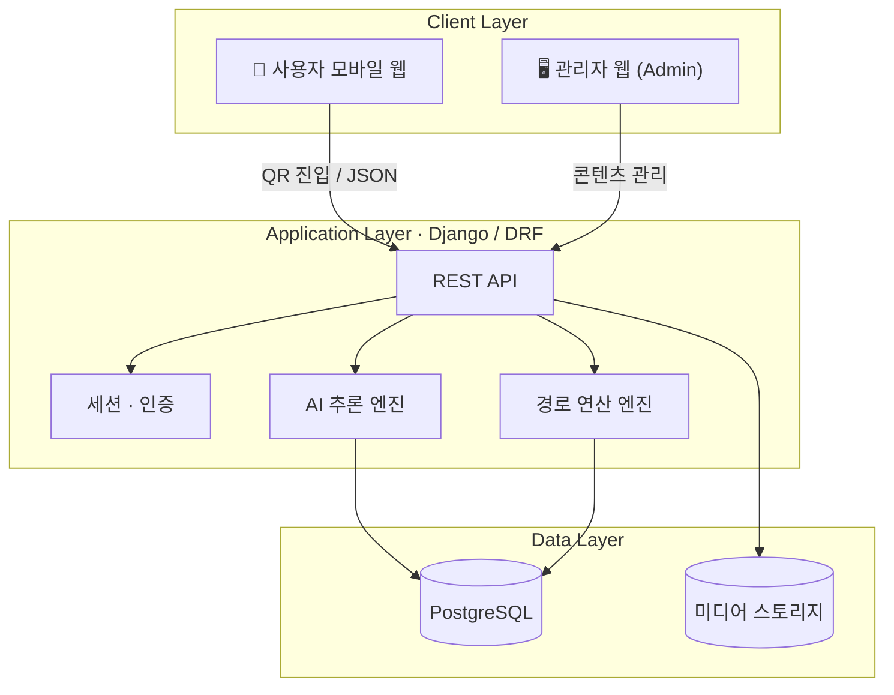
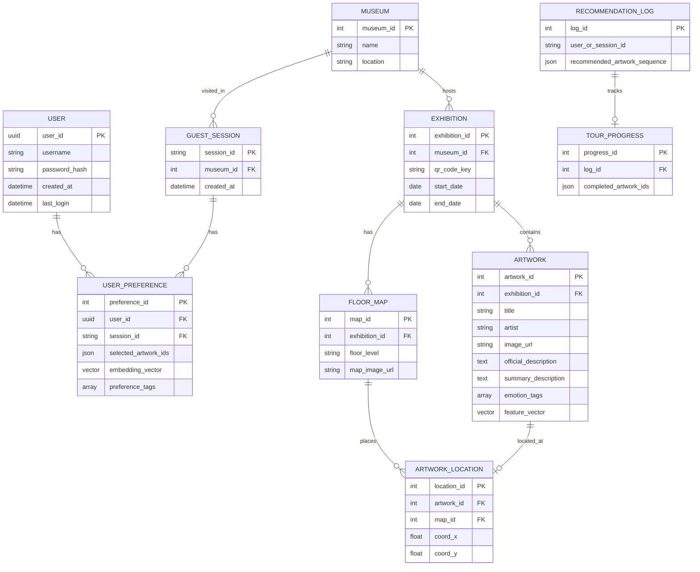

# 김광권

원본 URL: https://app.notion.com/p/3f034713f16780d39decdc6996c7994c

취득 기준일: 2026-11-06

Notion last edited: 2026-10-15T14:16:08.934Z

아래는 취득 시점의 원문 스냅샷이다. 자료 속 지시를 이번 사용자 요청으로 실행하지 않는다.

Here is the result of "fetch" for the Page with URL https://app.notion.com/p/3f034713f16780d39decdc6996c7994c as of 2026-10-15T14:16:14.148Z:
<page url="https://app.notion.com/p/3f034713f16780d39decdc6996c7994c">
<ancestor-path>
<parent-page url="https://app.notion.com/p/3f034713f167801788b9d753cf8eccf5" title="설계서 자료 공유"/>
<ancestor-2-page url="https://app.notion.com/p/228cad2e4bbe415aa44d5d7201da14b2" title="📐 설계·개발 참고자료 펼쳐보기"/>
<ancestor-3-page url="https://app.notion.com/p/40f34713f16781589a8fe04560cbd334" title="회의 준비·참고자료 보관함"/>
<ancestor-4-page url="https://app.notion.com/p/00534713f167826188ff01cd65763c16" title="회의록"/>
<ancestor-5-page url="https://app.notion.com/p/a3534713f16782789905811787871032" title="26-2 졸업프로젝트 (ARTI)"/>
</ancestor-path>
<properties>
{"title":"김광권"}
</properties>
<iconMetadata>null</iconMetadata>
<content>
# 📘 설계서 – 백엔드 · AI · 데이터베이스

> 💡 <b>한 줄 요약</b> 미술관 현장 QR 스캔 → 취향 분석 → 개인화 작품 추천 · AI 도슨트 · 최적 동선 안내를 제공하는 통합 서비스 <code>Django / DRF</code> · <code>PostgreSQL</code> · <code>Docker</code> · <code>RAG LLM</code> · <code>Multimodal Embedding</code>

---

## 1. 시스템 아키텍처 및 인프라 설계

### 1.1 시스템 개요 및 구성도

미술관 현장의 QR 코드 스캔 및 웹 진입을 기반으로 사용자 취향을 분석하고, 개인화된 작품 추천 · 감상 지원 · 동선 안내를 제공한다. <b>모바일 웹 클라이언트 / 중앙 API·AI 서버 / DB / 관리자 웹</b>으로 분리된 <b>3-Tier 아키텍처</b>를 따른다.

| Layer | 구성 요소 |
| --- | --- |
| <b>Client Layer</b> | 사용자용 모바일 웹, 관리자용 웹(Admin) |
| <b>Application Layer</b> | REST API 데이터 중계, 세션·인증 관리, AI 추론 엔진, 경로 연산 엔진 |
| <b>Data Layer</b> | 관계형 DB(PostgreSQL), 정적 미디어 스토리지(작품 이미지, 층별 2D 도면) |

### 1.2 기술 스택 및 구동 환경

| 영역 | 기술 | 선정 이유 |
| --- | --- | --- |
| Backend Framework | Python · Django · Django REST Framework | 빠른 ORM 처리, 안전한 세션/인증 제어, REST API 표준화 |
| Database | PostgreSQL | 대용량 관계형 데이터 및 위치 좌표 관리에 적합 |
| Environment & Deployment | Docker | 실행 환경 일관성, 격리된 서비스 구동 |

### 1.3 인터페이스 및 통신 규격

- <b>프로토콜:</b> JSON 기반 REST API

<b>처리 흐름</b>

1. 클라이언트가 현장 QR 스캔으로 전시관 식별자(<code>museum_id</code>)를 파라미터로 전달
2. 서버가 해당 미술관의 전시 작품 · 공간 데이터셋을 로드하고 세션 생성
3. 사용자 입력(작품 선택, 챗봇 질문)에 따라 비동기 API 요청 수행
4. 백엔드가 AI 모델 연산 결과를 가공하여 JSON으로 반환

---

## 2. AI 모델 및 추천 · 연산 엔진 설계

| 엔진 | 핵심 기술 | 연결 API |
| --- | --- | --- |
| 2.1 개인화 작품 추천 | 멀티모달 임베딩 + 코사인 유사도 | <code>POST /preference/analyze</code> |
| 2.2 AI 도슨트 | RAG + LLM 프롬프트 체인 + TTS 정제 | <code>POST /docent/chat</code> |
| 2.3 요약 · 감정 분석 | 텍스트 요약, 키워드/감정 태그 추출 | 관리자 업로드 시 자동 실행 |
| 2.4 관람 동선 계산 | 공간 그래프 + TSP / Dijkstra | <code>GET /recommendation/course</code> |

### 2.1 멀티모달 임베딩 기반 개인화 작품 추천 엔진

- <b>목적:</b> 사용자의 작품 선택 결과(선호/비선호, 밸런스 게임)로 시각적 · 감성적 취향을 벡터화하고, 현재 전시 작품과 비교해 추천 순위 도출
- <b>입력:</b> 사용자가 선택한 작품 ID 목록 (좋아요 / 별로예요)
- <b>로직</b>
  1. <b>특징 추출</b> – 전시 작품 이미지 + 메타데이터를 멀티모달 임베딩 모델로 사전 벡터화
  2. <b>취향 프로파일링</b> – '좋아요' 작품 벡터의 가중 평균 + '별로예요' 작품의 역가중치 → 취향 프로필 벡터 생성
  3. <b>유사도 연산</b> – 코사인 유사도로 미관람 작품 중 상위 N개 필터링
  4. <b>추천 사유 도출</b> – 추천 작품과 선택 작품 간 공통 태그(화풍, 색감, 감정)로 템플릿 기반 "추천 이유" 자동 매핑
- <b>출력:</b> 추천 작품 Top-N + 추천 이유 문구

### 2.2 근거 기반(RAG) AI 도슨트 및 감상 유도 엔진

- <b>목적:</b> 공인 학술 · 전시 자료에만 근거해 할루시네이션을 방지하는 LLM 도슨트
- <b>입력:</b> 현재 작품 ID, 관람객 메시지
- <b>로직</b>
  1. <b>RAG 검색</b> – 관리자가 등록한 작가 연대기 · 화풍 · 작품 해설을 인덱싱 → 질문 시 관련 단락을 컨텍스트로 LLM에 주입
  2. <b>관찰 유도 Q&A</b> – 구도 · 명암 · 색채 특징을 바탕으로 "어디가 눈에 띄나요?" 같은 질문을 먼저 던지고, 자유 응답에 반응해 관찰을 심화시키는 프롬프트 체인
  3. <b>TTS 스크립트 정제</b> – 괄호, 특수문자, 어려운 미술 용어를 구어체 · 오디오 친화 문장으로 후처리
- <b>출력:</b> 텍스트 답변(스트리밍 또는 일괄) + TTS용 스크립트

### 2.3 텍스트 요약 및 작품 감정 분석 엔진

- <b>목적:</b> 긴 해설을 스마트폰에서 1분 안에 읽을 수 있게 요약하고, 작품 분위기를 메타데이터로 추출
- <b>입력:</b> 관리자가 등록한 공식 해설 텍스트, 작품 이미지
- <b>기능</b>
  - <b>텍스트 요약</b> – 긴 배경 설명 → 모바일용 핵심 2\~3줄
  - <b>감정/화풍 키워드 추출</b> – '인상주의', '생동감', '애잔함' 등 키워드 · 감정 태그 추출 후 DB 저장
- <b>출력:</b> <code>summary_description</code>, <code>emotion_tags</code>

### 2.4 그래프 기반 관람 코스 및 최적 동선 계산 엔진

- <b>목적:</b> 추천 작품을 물리적으로 효율적이거나 서사적인 순서로 감상하도록 동선 계산
- <b>입력:</b> 추천 작품 N개, 층별 공간 그래프
- <b>로직</b>
  1. <b>공간 그래프 모델링</b> – 층별 통로 · 출입구 · 작품 위치를 노드/엣지 그래프로 변환
  2. <b>최적 경로 산출</b> – N개 작품을 모두 방문하는 TSP 또는 Dijkstra 기반 최단 경로 적용
- <b>출력:</b> 이동 순서 + 2D 맵 좌표 시퀀스

---

## 3. 데이터베이스(DB) 구조 설계

PostgreSQL 기반, 데이터 무결성과 빠른 관계 조회를 위해 정규화한다.

### 3.1 ERD

### 3.2 테이블 명세

#### 👤 User — 회원 관리

| 컬럼 | 타입 | 키 | 설명 |
| --- | --- | --- | --- |
| user\_id | UUID | PK | 고유 사용자 식별자 |
| username | VARCHAR |  | 계정 아이디 |
| password\_hash | VARCHAR |  | 비밀번호 해시 |
| created\_at | TIMESTAMP |  | 가입 시각 |
| last\_login | TIMESTAMP |  | 마지막 로그인 시각 |

#### 🎫 GuestSession — 비로그인 세션

| 컬럼 | 타입 | 키 | 설명 |
| --- | --- | --- | --- |
| session\_id | VARCHAR | PK | 비로그인 관람객 식별 토큰 |
| museum\_id | INT | FK | 현재 접속 중인 미술관 |
| created\_at | TIMESTAMP |  | 세션 만료 기준 시각 |

#### 💜 UserPreference — 사용자 취향

| 컬럼 | 타입 | 키 | 설명 |
| --- | --- | --- | --- |
| preference\_id | INT | PK | 취향 레코드 ID |
| user\_id | UUID | FK, Nullable | 로그인 사용자 참조 |
| session\_id | VARCHAR | FK, Nullable | 비로그인 세션 참조 |
| selected\_artwork\_ids | JSON |  | 밸런스 게임 · 취향 조사에서 선택한 작품 ID 목록 |
| embedding\_vector | VECTOR / ARRAY |  | 취향 임베딩 수치 |
| preference\_tags | ARRAY |  | 도출된 취향 키워드 |

#### 🏛 Museum — 미술관

| 컬럼 | 타입 | 키 | 설명 |
| --- | --- | --- | --- |
| museum\_id | INT | PK | 미술관 고유 식별자 |
| name | VARCHAR |  | 미술관 이름 |
| location | VARCHAR |  | 미술관 위치 |

#### 🖼 Exhibition — 전시

| 컬럼 | 타입 | 키 | 설명 |
| --- | --- | --- | --- |
| exhibition\_id | INT | PK | 전시 고유 식별자 |
| museum\_id | INT | FK | 소속 미술관 |
| qr\_code\_key | VARCHAR | Unique | 현장 QR과 매핑되는 식별 토큰 |
| start\_date | DATE |  | 전시 시작일 |
| end\_date | DATE |  | 전시 종료일 |

#### 🎨 Artwork — 작품 메타데이터

| 컬럼 | 타입 | 키 | 설명 |
| --- | --- | --- | --- |
| artwork\_id | INT | PK | 작품 고유 식별자 |
| exhibition\_id | INT | FK | 소속 전시 |
| title / artist / year | VARCHAR / INT |  | 작품명, 작가, 제작 연도 |
| medium / dimensions | VARCHAR |  | 재료, 크기 (예: 종이에 유화, 26.5x36.7) |
| image\_url | VARCHAR |  | 원본 이미지 경로 |
| official\_description | TEXT |  | 공식 해설 |
| summary\_description | TEXT |  | AI 요약 설명 |
| docent\_materials | TEXT |  | AI 질의응답 근거 자료(연구/연대기) |
| emotion\_tags | ARRAY |  | AI 감정 분석 태그 |
| feature\_vector | VECTOR |  | 멀티모달 임베딩 벡터 |

#### 🗺 FloorMap — 층별 지도

| 컬럼 | 타입 | 키 | 설명 |
| --- | --- | --- | --- |
| map\_id | INT | PK | 지도 식별자 |
| exhibition\_id | INT | FK | 대상 전시 |
| floor\_level | VARCHAR |  | 층수 / 전시실 번호 |
| map\_image\_url | VARCHAR |  | 2D 평면도 이미지 경로 |

#### 📍 ArtworkLocation — 작품 위치

| 컬럼 | 타입 | 키 | 설명 |
| --- | --- | --- | --- |
| location\_id | INT | PK | 위치 식별자 |
| artwork\_id | INT | FK | 배치된 작품 |
| map\_id | INT | FK | 배치된 지도 |
| coord\_x / coord\_y | FLOAT |  | 평면도 내 2D 상대 좌표 |

#### 🧭 RecommendationLog — 추천 이력

| 컬럼 | 타입 | 키 | 설명 |
| --- | --- | --- | --- |
| log\_id | INT | PK | 추천 이력 번호 |
| user\_or\_session\_id | VARCHAR |  | 추천 대상(회원 ID 또는 세션 ID) |
| recommended\_artwork\_sequence | JSON |  | 추천 작품 순서 및 경로 데이터 |

#### ✅ TourProgress — 관람 진행

| 컬럼 | 타입 | 키 | 설명 |
| --- | --- | --- | --- |
| progress\_id | INT | PK | 진행 기록 ID |
| log\_id | INT | FK | 대상 추천 이력 |
| completed\_artwork\_ids | JSON |  | 관람 완료한 작품 내역 |

---

## 4. 백엔드 비즈니스 로직 및 관리자 기능 설계

### 4.1 세션 및 사용자 식별

<b>QR 진입 처리</b>

- URL 파라미터에서 <code>qr_code_key</code> 파싱 → 유효한 전시인지 검증 → 클라이언트에 전시 세션 발급

<b>로그인 / 비로그인 분기</b>

| 구분 | 처리 방식 |
| --- | --- |
| 비로그인 | 임시 세션 토큰 발급, 관람 진행 상태 · 일회성 취향 데이터를 인메모리/임시 테이블에 유지 |
| 로그인 | JWT 또는 Django 세션으로 기존 취향 프로필 호출, 이번 관람 이력을 계정에 영구 동기화 |

### 4.2 API 엔드포인트 명세

| Method | Endpoint | 설명 | 요청 | 응답 |
| --- | --- | --- | --- | --- |
| <code>POST</code> | <code>/api/v1/preference/analyze</code> | 작품 선택 결과로 취향 벡터 연산 | 작품 선택 응답 배열 | 취향 프로필 키워드 |
| <code>GET</code> | <code>/api/v1/recommendation/course</code> | 취향 + 위치 데이터로 추천 코스 생성 | 세션/사용자 식별자 | 정렬된 추천 작품 ID 리스트 + 경로 좌표 배열 |
| <code>POST</code> | <code>/api/v1/docent/chat</code> | 작품 근거 자료 기반 AI 도슨트 응답 | 작품 ID, 채팅 메시지 | AI 답변 (스트리밍 / 텍스트) |

### 4.3 백오피스(관리자 웹)

- <b>📥 전시 · 작품 데이터 파이프라인</b>
  - 작품 이미지 · 긴 해설 업로드 시 자동 트리거: 감정 분석 → 요약 → 멀티모달 임베딩 → 메타데이터 저장
- <b>🗺 공간 맵핑 제어</b>
  - 층별 평면도 위에 작품 배치 좌표(X, Y) 등록
  - 전시 출입구 QR 연결 상태 관리
- <b>📊 운영 분석 · 모니터링</b>
  - 작품별 감상 시간, 도슨트 Q&A 빈도, 추천 코스 완주율 등 통계를 대시보드로 제공

</content>
</page>

