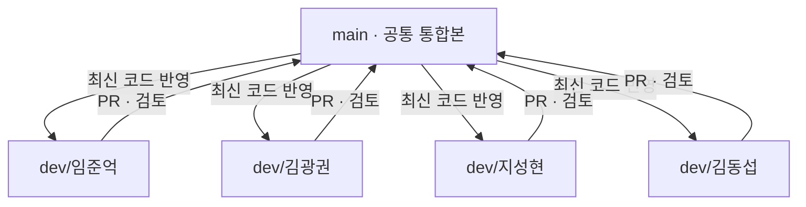

# 🌿 개인 브랜치와 PR 흐름 한눈에 보기

[← ARTI 메인으로](../README.md) · [실제 시작 방법](처음-시작하기.md)

## 브랜치는 별도 저장소가 아닙니다

**`arti` 저장소 하나** 안에서 각자 작업한 내용을 따로 관리하는 방법입니다. 개인 브랜치에는 `frontend/`, `backend/` 등 **전체 프로젝트가 들어 있으며**, 해당 사람 이름의 폴더만 있는 것은 아닙니다.

## 작업 예시

**지성현 팀원이 취향 선택 화면을 개발한다면**

1. `dev/지성현`에서 코드를 수정하고 실행해 봅니다.
2. `feat: 작품 취향 선택 화면 구현`으로 커밋합니다.
3. GitHub에 push한 다음 `dev/지성현 → main` PR을 생성합니다.
4. PR에 변경 내용과 테스트 결과를 한국어로 적습니다.
5. 팀원 검토 후 `main`에 병합합니다.
6. 이후 다른 팀원은 최신 `main`을 자기 브랜치에 반영합니다.

**병합했다고 자동으로 배포되는 것은 아닙니다.** 배포 환경 및 CI는 실제 개발 단계에서 설정해야 합니다.

## 많이 물어보는 것

| 질문 | 답 |
| --- | --- |
| 개인 브랜치를 새로 만들어야 하나요? | 아니요. 처음부터 팀원별 `dev/이름` 브랜치가 준비돼 있습니다. |
| main에서 바로 작업해도 되나요? | 팀 규칙상 개인 브랜치에서 작업해 PR로 합칩니다. |
| 개인 브랜치는 계속 최신인가요? | 처음엔 main과 같지만, main이 바뀌면 다시 동기화해야 합니다. |
| Issue를 무조건 만들어야 하나요? | 아니요. 기본 작업·담당·일정은 Notion에서 관리합니다. |
| 커밋 제목은 영어여야 하나요? | `feat:` 등 유형만 영어, 뒤의 설명은 한국어입니다. |
| PR을 올리면 꼭 바로 병합해야 하나요? | 아닙니다. 확인·테스트·수정 후 병합합니다. |

자세한 명령어는 [처음 시작하기](처음-시작하기.md), 세부 원칙은 [협업 규칙](협업-규칙.md)에 있습니다.
