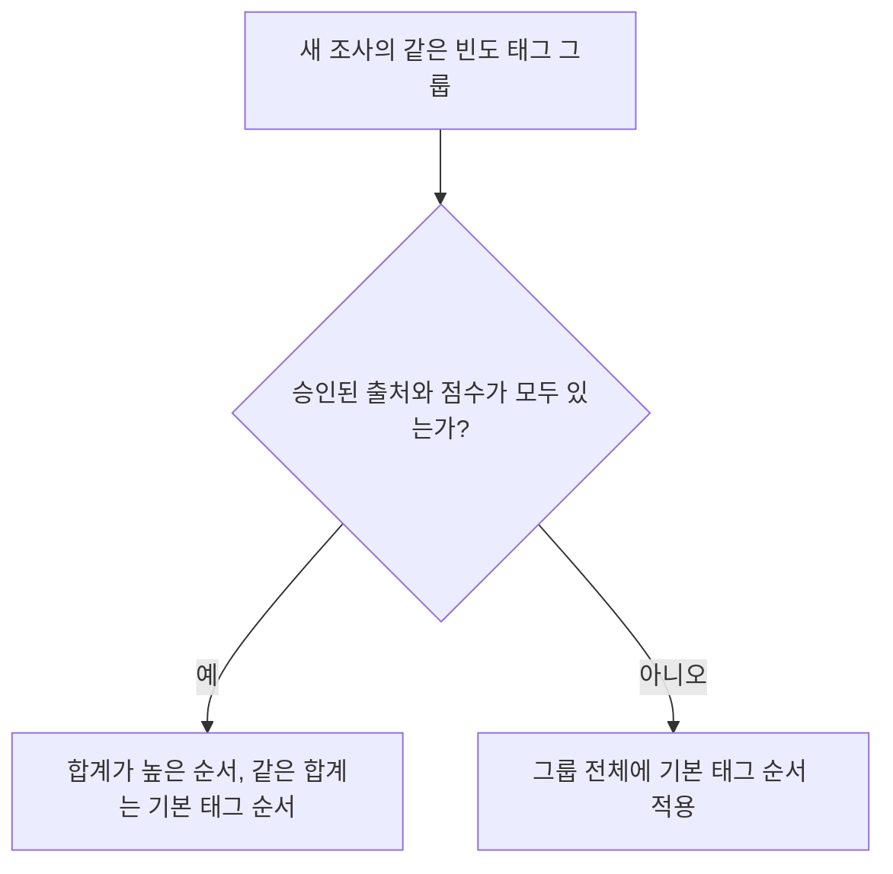

# 2026-11-11 임준억 · 취향 동점 처리와 관람 반영

> **기록자** 임준억 · **기준일** 2026-11-11 KST

[11/11 작업 일지](2026-11-11.md) · [동점 처리 계약](../2026-11-11_R04_프론트인수와동점처리계약.md) · [구현 상세 계획](../2026-11-11_R04_동점구현상세계획.md) · [단계별 검증 증거](../../execution-plan/2026-11-07/records/taste-tie-implementation-results-2026-11-11/README.md)

격리 환경에서 작품 선택부터 추천·지도·감상·도슨트·영수증까지 완주했다. 실제 작품·태그의 독립 검수와 공개 대상 판단은 다음 작업으로 남겼다.

## 변경 이유와 동점 규칙

11/10 팀 논의에서 작품 선택 빈도가 같은 태그의 순서가 고정 기준에 좌우된다는 문제가 나왔다. 검증된 모델 점수를 동점의 보조 근거로 쓰기로 했지만, 기존 응답의 모델명과 점수만으로는 어떤 이미지·모델·보정 설정에서 계산했는지 확인하기 어려웠다. 출처 전달과 저장을 먼저 만들고 서버 미리보기와 추천에 같은 계산을 적용했다. 사용자가 미리 본 취향을 확인하면 그 근거가 관람 기록까지 이어지도록 연결했다.

서버는 기존 태그 빈도 가중치와 추천 작품 수를 유지한다. **새 조사에서 같은 빈도의 태그끼리만** 점수 합계를 비교한다. 승인된 출처나 점수가 하나라도 빠지면 그룹 전체에 기존 서버 태그 순서를 적용한다. 모든 근거가 유효하면 합계가 높은 태그부터 정렬하고, 합계까지 같은 태그끼리는 기존 서버 태그 순서를 따른다.

## 단계별 결과

| 단계 | 다음 단계로 이어진 결과 | 통과 기준 |
| --- | --- | --- |
| [TP1a](#tp1a-모델-점수-출처-전달) | 모델 점수에 출처를 붙여 Django에서 확인 | A1~A4 |
| [TP1b](#tp1b-점수와-출처-원자-저장) | 출처를 점수·revision과 한 번에 저장 | B1~B6 |
| [TP2](#tp2-서버-동점-계산과-저장-보호) | 서버 미리보기·추천·저장에 공통 규칙 적용 | P2-01~P2-09 |
| [TP3](#tp3-사용자-확인과-관람-반영) | 사용자 확인 후 계정 저장 또는 이번 관람에 적용 | P3-01~P3-06 |
| [TP4](#tp4-격리-통합-검증) | 관람 완주, 출처 대조, 비활성화와 복구 검증 | P4-01~P4-06 |

## TP1a 모델 점수 출처 전달

**시작 배경**

FastAPI가 모델명과 점수만 반환해 실제 입력과 설정을 대조할 수 없었다.

**작업과 변경 파일**

- 선택적 `tagEvidence`에 실제 이미지 바이트, 점수, 고정 CLIP 모델·processor, 계산·보정 정의의 해시를 묶었다. 전체 모델이 로딩되고 고정 캐시 파일이 로딩 전후 같을 때만 근거를 반환한다. Django는 누락·null을 기존 방식으로 처리하고, 잘못된 근거는 정제된 502로 응답한다. 감정 결과에 새 근거가 먼저 저장될 수 있던 경로도 막았다.
- `ai-service/app/`의 `provenance.py`, `analyzer.py`, `image_fetch.py`, `main.py`, `config.py`와 Django의 `arti/model_service.py`, `arti/providers.py`를 수정했다. `.env.example`에 선택적 `ARTI_CLIP_REVISION`을 안내했다. [모델 운영 안내](../../operations/모델서비스_로컬운영.md)

**검증 결과**

모델 38건(신규 15건), Django 23건(신규 메서드 5개), 기존 스크립트 53건 통과. 첫 ASGI 시험 정지 후 로컬 소켓에서 재실행하고, 부분 로딩·캐시 변경·보정값 복사본을 추가로 시험했다. 합성 점수의 로컬 HTTP 수신 경로에서 DB 접근은 0회였다. 기존 TestClient 사용 중단 경고 1건이 남았다. 실제 가중치 시험은 TP4에서 했다. 구현 커밋 `41f8fb8`. [TP1a 검증 증거](../../execution-plan/2026-11-07/records/taste-tie-implementation-results-2026-11-11/TP1a/README.md)

## TP1b 점수와 출처 원자 저장

**시작 배경**

작품 행에 점수만 저장했다. 원문·이미지가 바뀐 뒤 과거 근거를 현재 입력의 근거와 구분할 방법이 필요했다.

**작업과 변경 파일**

- 점수·출처·revision을 한 트랜잭션에서 저장하고, 기존 행은 출처 null·revision 0으로 호환했다. 재분석마다 revision을 올리며, 새 점수의 출처가 없으면 null을 저장한다. 원문·이미지가 바뀌면 과거 근거는 보존하고 현재 근거 조회에서 제외한다.
- **실패 처리** — 오래된 버전은 409, 잠금 대기 2초 초과는 재시도 가능한 503, 전체 시간 예산 초과는 롤백으로 처리한다. 태그 실패와 별개로 성공한 요약을 저장하는 기존 정책도 유지했다.
- Django `arti/`의 `models.py`, `migrations/0003_tag_score_evidence.py`, `tag_scores.py`, `providers.py`, `editing.py`, `tests/test_tag_persistence.py`. 클라이언트의 점수·출처·revision 주입을 차단하고 공개·관리자 응답에서 내부 출처를 제외했다.

**검증 결과**

격리 PostgreSQL에서 Django 138건(신규 18건), 기존 스크립트 53건 통과. 별도 연결에서 중간값 비노출, 전체 롤백, 동시 저장 한 건 반영, 기존 확정값 보호를 확인했다. 첫 전체 회귀에서 발견한 Windows 이미지 파일 핸들 문제는 시험이 다운로드 스트림을 끝까지 읽도록 고친 뒤 재검증했다. 구현 커밋 `11edcff`. [TP1b 검증 증거](../../execution-plan/2026-11-07/records/taste-tie-implementation-results-2026-11-11/TP1b/README.md)

## TP2 서버 동점 계산과 저장 보호

**시작 배경**

저장한 모델 근거를 읽기 전용 미리보기·추천·회원 저장에 연결하는 공통 경로가 없었다.

**작업과 변경 파일**

- 미리보기와 추천에 같은 서버 계산을 적용했다. 조사 근거 버전에는 선택하지 않은 작품의 근거도 포함했다. 회원 저장은 버전과 요청 ID를 확인해 동시 수정 한 건만 반영하고 같은 요청의 재시도에 204를 반환한다. 호환 필드를 추가해 기존 프로필도 보존했다.
- **관람 기록 보호** — 관람 근거는 이용자·관람 ID·프로필에 묶어 서명한다. 풀 교체 후의 첫 영수증 저장과, 이미 저장된 요청을 만료 후 동일하게 재시도하는 경우를 구분한다.
- Django `arti/`의 `taste_resolution.py`, `taste_evidence.py`, `survey.py`, `recommendations.py`, `member.py`, `records.py`, `migrations/0004_taste_write_receipt.py`.

**검증 결과**

격리 Django 150건(신규 12건), 계약 반례 30개, 스크립트 53건, 이관·Compose 설정 검사 통과. 미리보기에서 DB·미디어 변경과 모델 호출이 각각 0건이었다. 위조 입력의 500을 400으로 고쳤고, 잠금 대기 중 풀이 바뀌면 409로 재조회하도록 보완했다. 구현 커밋 `ba3b6dc`. [TP2 검증 증거](../../execution-plan/2026-11-07/records/taste-tie-implementation-results-2026-11-11/TP2/README.md)

## TP3 사용자 확인과 관람 반영

**시작 배경**

조사 화면에서 취향을 먼저 반영하던 흐름을 서버 미리보기·사용자 확인·최종 반영 순으로 바꿀 필요가 있었다.

**작업과 변경 파일**

- 작품 선택·태그 편집·미리보기·사용자 확인을 구분했다. 같은 취향이면 현재 관람을 이어가고, 새 취향은 확인에 성공한 뒤 적용한다. 충돌과 지연 응답에도 작성 중인 선택과 기존 관람을 보호한다.
- **재시도와 관람 ID** — 계정 저장 응답 유실과 저장 성공 뒤 계정 조회 실패를 별도로 처리한다. 첫 시간 선택에서도 서명된 관람 ID를 유지하고, 저장 대기 중인 영수증 요청은 새로고침 뒤 복원한다.
- `frontend/src/`의 `components/TasteReview.tsx`, `lib/tasteFlow.ts`, `lib/visitScope.ts`, `lib/receiptPayload.ts`, `pages/user/`의 U05·U06·U07·U12 화면, `store/VisitContext.tsx`.

**검증 결과**

프론트 33건(신규 8건), 빌드, 합성 API를 연결한 격리 Chrome 여정 통과. 연결을 끊으면 Chrome이 PUT을 자동 재전송해, 저장 후 중간 서버가 504를 보내는 조건으로 시험을 바꿨다. 이 조건에서 사용자의 명시적 재시도와 기존 관람 보존을 확인했다. 구현 커밋 `c192974`. [TP3 검증 증거](../../execution-plan/2026-11-07/records/taste-tie-implementation-results-2026-11-11/TP3/README.md)

## TP4 격리 통합 검증

**시작 배경**

TP3까지 화면과 API를 단계별로 검증했다. 실제 DB·서버를 붙였을 때 취향 확인 결과와 모델 출처가 영수증까지 이어지고, 기능을 껐다 켜도 기존 관람이 보존되는지 확인해야 했다.

**작업과 변경 파일**

- **관람 여정** — 실제 Django·별도 PostgreSQL 17·Chrome에서 10점·5쌍 선택 → 추천 → 지도 → 세 작품 감상·관람가이드 → 도슨트 → 영수증까지 완주했다. v1의 3·5·7점 추천 응답 전체를 기존 구현과 대조했고, v2는 기존 가중치와 검증된 동점 순서를 확인했다.
- **모델과 도슨트 범위** — 고정 CLIP 캐시에서 합성 이미지 한 장을 실제 추론해 입력·모델·processor·보정·점수 근거를 DB와 대조했다. v2의 다섯 조사 항목에는 같은 이미지 바이트의 결과를 재사용했다. 도슨트는 로컬 OpenAI 호환 시험 제공자로 질문·가이드 맥락 전달과 출처 참조를 확인했다.
- **결함과 변경 파일** — 재시작 전후에 체류 시간이 같은 작품 중 영수증의 ‘가장 오래 본 작품’이 달라졌다. Django `arti/records.py`와 프론트 `lib/receiptPayload.ts`에서 관람 순서를 동점 기준으로 맞췄다. 최초 저장·동일 요청 재시도·재시작 후 조회가 일치했고 관람·반응 행은 중복되지 않았다. 보완 커밋 `d051469`.

**검증 결과**

v2 비활성화·재활성화 때 기존 프로필과 영수증, 이전에 발급한 미저장 관람 근거의 첫 저장을 확인했다. 일반 환경의 DB·미디어·활성 풀·원본 16점은 전후 자료로 대조했고 격리 DB는 검증 후 종료했다. Django 151건, 프론트 34건, 모델 계약 38건, 스크립트 53건과 빌드·타입·이관·계획 검사 통과. [TP4 검증 증거](../../execution-plan/2026-11-07/records/taste-tie-implementation-results-2026-11-11/TP4/README.md)

## 남은 작업

- **작품과 태그 인수** — 유영국 핵심 3점과 취향 조사 후보의 독립 검수, 최종 10점·5쌍 선정, 공개 대상·사용 범위를 확인한다. 로컬 도슨트 제공자 시험과 합성 이미지 한 장의 CLIP 추론은 연결과 출처 검증 근거다. 실제 작품의 태그 적합도와 도슨트 답변 품질에는 별도 근거가 필요하다. [핵심 3점 검수 준비](../2026-11-11_W06_핵심3점독립검수인수준비.md)
- **프론트 인수** — 동섭님 종합본을 받으면 선별 반영 범위를 재확인한다. [프론트 인수 기록](../2026-11-11_실기기피드백_프론트인수.md)

기술·방문자·운영·팀·평가 관점 검토는 같은 작성자가 수행한 자체 검토다. 이 단계별 통과로 공식 W/G/AC 판정이나 공개 승인 상태를 변경한 이력은 없다.
